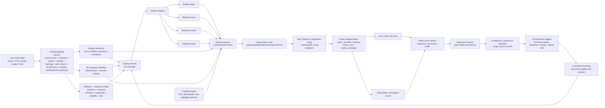
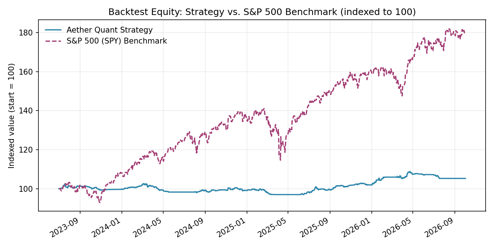
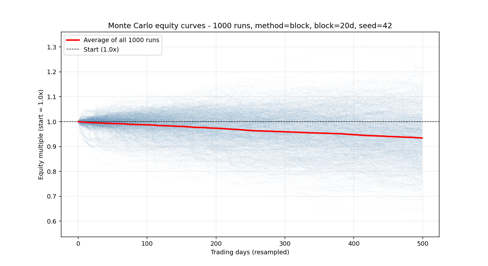

<p align="center">
  
</p>

<h1 align="center">Aether Quant</h1>

<p align="center">
  <strong>Aether Quant's flagship trading model: a dynamic, self-adapting algorithmic trading system built on QuantConnect Lean and PyTorch, engineered to prove that dynamic models belong in dynamic markets.</strong>
</p>

<p align="center">
  
  
  <!-- AQ:TEST_BADGE_START --><!-- AQ:TEST_BADGE_END -->
  
  
</p>

<p align="center">
  
  
  
  
  
  
  
  
  
  
  
</p>

Aether Quant is not a single static strategy. It's a **dynamic system**.
At its core, an ensemble of neural models predicts, for every asset every
day, a multi-horizon view of the market: **direction** at 1, 5 and 20 days,
expected **return magnitude** and **volatility**, and the signal it actually
trades on: each asset's **cross-sectional rank**, which drives a
market-neutral **long/short book**. Predictions come from a
**Mixture-of-Experts** ensemble (bullish/bearish/sideways/volatility
specialists) routed by a learned gating network, plus a **causal-TCN
sequence encoder**, all reading one feature pipeline that folds in a
**market-regime detector**, a **3D market topology** layer, and a
**liquidity/market-impact engine**. A **unified multi-asset-class layer**
trades equities, crypto, bonds, futures, options, and Forex through one
coherent portfolio — real yield-curve features for bonds, margin-aware
sizing for futures, greeks-based sizing for options, and shared cross-asset
macro signals feeding every asset's prediction — while a **controlled
retraining loop** lets the model evolve as markets do. Everything is wired
together and validated end-to-end inside QuantConnect's Lean engine. The
thesis this project exists to test: **markets are non-stationary, so a
trading model should be too.** Every subsystem here exists to make the model
adapt to regime shifts, changing correlation structure, and liquidity
conditions. The [Architecture](#architecture) section below has the full
picture; [`development/architecture.md`](development/architecture.md) goes
deeper still.

## Known Limitations

Bonds are fully real; futures and options are wired end to end but **data-empty until an Interactive Brokers key is connected** (`phase_v2.ib.enabled`, `aq ib status`).

- **No demonstrated out-of-sample edge.** The shipped book ends the 2023-07..2026-09 Lean span at +16.85% (Sharpe +0.082, drawdown 4.30%), but $10.7k of the $16.8k is T-bill carry. The strategy alone earned $6.1k (Sharpe +0.54 without a risk-free rate, deflated Sharpe 46% over 22 tested configurations) at 0.17x of NAV, because the rolling-IC gate vetoes most rebalances, and the span includes the already-seen holdout. No retrain or rule variant has beaten the installed stack by more than noise (V6.1-V6.4). V6.4's twelve leads found that the rolling-IC gate does not select good days (engaged-day rank IC 0.088 against 0.129 on the vetoed backtest days), that the direction heads carry no calibrated information, and adopted two offline changes (a 10-session rebalance with a 20-session hold, as-live Sharpe validation -0.45 -> +0.15 and backtest +0.89 -> +1.06; crypto graduates out of the main book) that **no Lean run has confirmed yet**. The offline simulator tracks Lean at a daily correlation of ~0.7: a diagnostic, not a forecast. See [Backtest Statistics](#backtest-statistics). **Paper trading only; no live capital.**
- **Lean runs before V5.8.0 are not comparable**: they covered 2019-01..2021-03 on data that then ended there (`development/Problems.md` #145-#154, #185, #186).
- **IB is unverified end to end**: the connection, the opt-in live futures margin source (#67) and all 43 option structures (#38, #59) have never met a real Gateway; no option or future asset is in the universe yet.
- **Production safety is unit- and backtest-verified, not field-tested**: the kill switch, reconciliation and auto-rollback have run inside Lean backtests, never against a live broker / Postgres deployment over paper hours.

## Table of Contents

- [Known Limitations](#known-limitations)
- [Download](#download)
- [Getting Started](#getting-started)
- [Requirements](#requirements)
- [Architecture](#architecture)
- [Universe Size](#universe-size)
- [Project Structure](#project-structure)
- [Module Documentation](#module-documentation)
- [Development Documentation](#development-documentation)
- [Open Source Files](#open-source-files)
- [Backtest Statistics](#backtest-statistics)
  - [Overview](#overview)
  - [General Characteristics](#general-characteristics)
  - [Performance](#performance)
  - [Runs and Drawdowns](#runs-and-drawdowns)
  - [Implementation Shortfall](#implementation-shortfall)
  - [Return/Risk Efficiency](#returnrisk-efficiency)
  - [Classification Scores](#classification-scores)
  - [Attribution](#attribution)
  - [Robustness](#robustness): [Monte Carlo](#monte-carlo-simulation), [Walk-Forward](#walk-forward-trainingtesting)
  - [Offline vs Lean](#offline-vs-lean): [Lean vs Offline Books](#lean-vs-offline-books), [Offline Evaluation](#offline-evaluation), [As-Live Book](#as-live-book), [Benchmarks](#benchmark-comparison), [Cross-Checks](#cross-checks)
  - [Research and Audit](#research-and-audit)
  - [Disclaimer](#disclaimer)
- [Test Suite](#test-suite)
- [CLI Reference](#cli-reference)
  - [`aq train`](#aq-train)
  - [`aq test`](#aq-test)
  - [`aq backtest`](#aq-backtest)
  - [`aq profile`](#aq-profile)
  - [`aq report`](#aq-report)
  - [`aq api`](#aq-api)
  - [`aq webui`](#aq-webui)
  - [`aq docker`](#aq-docker)
  - [`aq config`](#aq-config)
  - [`aq lean`](#aq-lean)
  - [`aq retrain`](#aq-retrain)
  - [`aq paper-readiness`](#aq-paper-readiness)
  - [`aq trade-lock`](#aq-trade-lock)
  - [`aq kill-switch`](#aq-kill-switch)
  - [`aq evaluate`](#aq-evaluate)
  - [`aq fetch`](#aq-fetch)
  - [`aq backfill`](#aq-backfill)
  - [`aq ib`](#aq-ib)
  - [`aq assets`](#aq-assets)
  - [`aq render-lean-config`](#aq-render-lean-config)
  - [`aq secrets-check`](#aq-secrets-check)
  - [`aq audit-log`](#aq-audit-log)
  - [`aq status`](#aq-status)
- [Release Process](#release-process)
- [Roadmap](#roadmap)

---

## Download

If you just want to use Aether Quant rather than develop on it, no local
`pip install -e .` or source checkout is needed: the CLI and backend are
published as ready-to-use releases:

```powershell
pip install aether-quant
docker pull ghcr.io/leon1706-lol/aether-quant:latest
```

`aq --help` is then available immediately (see [CLI Reference](#cli-reference)
below). `aq` checks PyPI at most once every 24h (short timeout, never
blocking) for a newer version and prints a one-line notice if one's
available (disable with `AQ_SKIP_UPDATE_CHECK=1`).

The Docker image is the same one `docker-compose.yml`'s `engine` service
(and every worker service, which all share this one build,
`aether-quant-engine`) pulls by default (override with the
`AETHER_QUANT_IMAGE` env var, e.g. to use a locally built image instead).
This is the single consolidated image (app + every worker, includes the
full ML stack), so expect a larger download than a minimal API-only image.

## Getting Started

For local development (this repo cloned, a virtual environment active):

1. Install dependencies:

   ```powershell
   pip install -r requirements/requirements.txt
   pip install -r requirements/requirements-dev.txt   # local dev extras
   ```

2. Refresh the data inventory only:

   ```powershell
   python train.py --init-only
   ```

3. Build the dataset and train the model:

   ```powershell
   python train.py
   ```

   Or build dataset artifacts only, without training:

   ```powershell
   python train.py --dataset-only
   ```

4. Start the webui locally (two processes):

   ```powershell
   uvicorn monitoring.api_server:app --port 8001 --reload
   ```

   ```powershell
   cd webui
   npm install
   npm run dev
   ```

   Then open `http://localhost:3002`.

5. Run a real backtest and refresh this README's [Backtest Statistics](#backtest-statistics):

   ```powershell
   pip install -e .   # registers the `aq` command from source
   aq backtest
   ```
   First run downloads the pinned QuantConnect Lean engine Docker image once (~40GB+) and builds the small local `aether-quant-lean:17900` layer; budget time and bandwidth for it. Later runs reuse both images.

## Requirements

- **Python ≥ 3.10** for the training pipeline, `main.py`'s Lean algorithm, the FastAPI monitoring server, and the `aq` CLI.
- **QuantConnect Lean CLI** (`pip install lean`) for running backtests and paper/live trading.
- **Docker & Docker Compose** for the local infrastructure (Redis, PostgreSQL, and the background workers, experience persistence, performance triggers, controlled retraining, Telegram alerts).
- **Node.js** (for the `webui/` React/Vite dashboard).
- **GitHub CLI (`gh`)** — optional, only needed to reproduce model training via a GitHub Codespace (this project's own convention for offloading training off a resource-constrained dev machine; see `development/Problems.md` #71).

This repo splits its Python dependencies across several `requirements*.txt`
files (full training stack vs. minimal per-Docker-image installs vs. local
dev extras) rather than one monolithic file. See
**[`requirements/README.md`](requirements/README.md)** for the exact
`pip install` command for every variant and which Dockerfile consumes each one.

## Architecture

Aether Quant runs a daily-bar decision pipeline entirely inside Lean's
`on_data()` callback: features (including bond/macro and options-implied
alt-data) flow through regime detection and 3D topology modeling (a
deterministic embedding plus a learned overlay), both feed a gating
network that routes across four specialized experts, an asset-class
router sizes the decision across equities/crypto/bonds/futures/options/
Forex, and every decision is persisted through a Redis → PostgreSQL
experience pipeline that a controlled retraining loop reads from to
evolve the model over time.

#### System Flow



#### Tech Stack

```mermaid
flowchart TB
    A["Infrastructure"] --> A1["Docker Compose<br/>(Redis, Postgres, aether-quant app)"]
    A --> A2["Lean CLI<br/>(backtest + paper trading, local only)"]
    A --> A3["30-day observation phase before live mode"]
    A --> A4["GitHub Codespaces<br/>(cloud training compute)"]
    B["Development"] --> B1["VS Code + Claude Code"]
    B --> B2["GitHub"]
    C["Data and storage"] --> C1["Lean data folder for training/backtesting"]
    C --> C2["Redis temporary event stream"]
    C --> C3["PostgreSQL permanent experience database"]
    D["AI and modeling"] --> D1["PyTorch"]
    D --> D2["scikit-learn"]
    D --> D3["NumPy / Pandas"]
    D --> D4["MoE experts and gating network"]
    D --> D5["Multitask heads (direction/magnitude/<br/>volatility/rank) + causal-TCN sequence encoder"]
    E["Monitoring and UI"] --> E1["React/Vite webui, Tracing dashboard (port 3002 dev / 8001 Docker)"]
    E --> E2["FastAPI JSON API (port 8000)"]
    E --> E3["Telegram alerts<br/>notifications/telegram_worker.py"]
```



These two diagrams are the high-level summary. For the full system —
every subsystem contract, the module map, the multi-asset-class and
signal-promotion-gate design, and an honest analysis of what would need
to change for this to become a genuinely low-latency/HFT system — see
**[`development/architecture.md`](development/architecture.md)**.

#### The model stack

Three model families are trained and shipped, all reading the same
train/runtime-parity feature pipeline (shared pure functions, never
hand-matched formulas, `features/`, `main.py::_build_model_input()`):

- **Baseline + 4 experts** (`train.py::AetherNet*`) — a direction model
  plus bullish/bearish/sideways/volatility specialists, routed by the
  learned gating network (`moe/gating.py`). Each also carries optional
  multitask heads for return magnitude and volatility.
- **Multitask model** (`AetherNetMultiTaskHorizons`, `train_multitask.py`)
  — a shared trunk with multiple heads: next-day direction,
  `direction_5d`/`direction_20d`, and the cross-sectional rank heads
  (`rank_5d`/`rank_20d`, plus market/sector/size-**residualized** variants
  that measure real skill rather than beta). `rank_20d` is the primary
  trading signal.
- **Sequence encoder** (`AetherNetSequenceMultiTaskHorizons`,
  `train_sequence.py`) — a causal-TCN over a rolling 30-bar window of the
  same inputs, adding temporal structure the flat-MLP trunk can't see;
  its `rank_5d` head is the strongest signal in this project's history.

Both trainers are trained directly against a differentiable ranking
objective (soft-Spearman/ListNet over whole-date cross-sectional batches),
not an MSE proxy — the model now optimizes for the thing it actually
trades on.

**66 model inputs** — not just price/volume: regime state (one-hot /
confidence / trend / risk), liquidity spread/dollar-volume, cross-asset
topology correlation/risk, correlated-peer lagged returns, 7 technical
indicators, real bond yield-curve/credit-spread features, alt-data
(options-implied volatility, financial-conditions change), and per-asset
macro **sensitivity betas** (rolling regression of each asset's return
against ΔVIX/Δreal-rate/Δcredit/Δdollar, so macro actually varies
cross-sectionally instead of shifting every asset equally) — all computed
offline and at runtime by the same code, with verified parity.

The rank heads drive a dollar- and sector-neutral long/short book
(`portfolio/book_neutrality.py`) with per-position sizing
(`risk/position_sizing.py`, bounded and direction-preserving) that's
scaled down when a trade's expected edge doesn't clear its expected
round-trip cost (`execution/cost_model.py`). Book sizing itself is
config-selectable (`phase_v2.portfolio_book.allocation_method`): the
default `"rank"` uses the confidence formula, while `"hrp"` re-weights
the same selected symbols with Hierarchical Risk Parity inverse-variance
weights from their correlation structure (`portfolio/book_construction.py::
apply_hrp_weights()`) — selection never changes, only sizing. An
automated kill switch, position reconciliation against the broker's
actual holdings, and an opt-in auto-rollback sit in front of all of it
(`risk/kill_switch.py`, `execution/reconciliation.py`,
`retraining/auto_rollback.py`). All of it
is visible on the `/neural-network`, `/evaluation`, and `/operations`
webui tabs and in `ml/*_training_metrics.json`.

See `inference/README.md`, `moe/README.md`, `risk/README.md`,
`regime/README.md`, `liquidity/README.md` and `topology/README.md` for
the full per-subsystem contracts, and `development/architecture.md` for
how it all fits together.

## Universe Size

The trading universe currently spans **104 assets**: 55 stocks/broad-market
ETFs, 22 fixed-income (bond) ETFs, 12 crypto pairs, and 15 forex/FX pairs
(53% equity / 21% bond / 12% crypto / 14% forex by count), defined in
`config.json`'s `phase1.universe.assets` and shared across training,
validation, and backtesting (common window `2014-12-01` to `2025-06-30`, then the `2025-07-01` to `2026-09-30` holdout).
Of these, tradeable names carry real positions while "observation-only"
names (thin history) are fed through the full model pipeline but never
sized. The 15 forex pairs (V4.10, fetched via `aq fetch forex`) all cover
the full common window with real Yahoo Finance history, unlike the 7
newly-added crypto pairs — expected to land "Trading" for the same reason,
though this hasn't been run through `train.py`'s actual asset-quality
classifier yet (left for a manual `python train.py --dataset-only` run,
same division of labor as this project's other deferred training steps).

See **[`development/asset_universe.md`](development/asset_universe.md)** for
the full ticker list, the trading-vs-observation split, the bond-ETF
duration/credit coverage, and the group-level diagram.

## Project Structure

The repository is a set of single-responsibility Python packages (one concern
per folder, each with its own README), a few top-level entry-point scripts
(`main.py` for the Lean algorithm, `train*.py` for the offline trainers,
`aq_cli.py` for the CLI), and the runtime config (`config.json` / `lean.json`).

See **[`development/project_structure.md`](development/project_structure.md)**
for the full annotated directory tree, and the
[Module Documentation](#module-documentation) table below for a per-package
index with links to each package's own README.

## Module Documentation

Every package below has its own README with the full detail on what it owns
and how it's wired in, this table is the index.

| Module | What it owns | Docs |
|---|---|---|
| `analyzer/` | Central market analyzer, the final per-asset action categorization layer | [README](analyzer/README.md) |
| `audit/` | Tamper-evident hash-chained audit log (credential loads, live-mode transitions, order path), Redis + PostgreSQL | [README](audit/README.md) |
| `backtests/` | Strategy validation output (active model + per-candidate reports), gitignored | [README](backtests/README.md) |
| `data/` | Local Lean data-folder format documentation | [README](data/README.md) |
| `data_pipeline/` | Lean-data contract + Yahoo Finance historical backfill | [README](data_pipeline/README.md) |
| `evaluation/` | Offline, cost-aware rank-book simulation (net Sharpe, turnover, capacity, cost stress) — the torch-free offline mirror of the live decision path | [README](evaluation/README.md) |
| `execution/` | Order gating, paper/live broker readiness, config-read caching, expected-net-edge cost model | [README](execution/README.md) |
| `experience/` | Observation/decision history, Redis buffer + PostgreSQL persistence | [README](experience/README.md) |
| `experts/` | Bullish, bearish, sideways, and volatility expert models | [README](experts/README.md) |
| `features/` | Shared feature-computation functions, called from both `train.py` and `main.py` for train/inference parity | [README](features/README.md) |
| `inference/` | Vectorized forward-pass interpreter for the exported neural networks | [README](inference/README.md) |
| `cpp_inference_ext/` | Optional C++/pybind11 accelerator (builds the `cpp_inference` module, never a hard dependency), a separate top-level folder name from the module it builds, deliberately, to avoid a namespace-package collision with the installed package | [README](cpp_inference_ext/README.md) |
| `liquidity/` | Liquidity and market-impact engine | [README](liquidity/README.md) |
| `ml/` | Model & dataset artifacts, including versioned retraining candidates | [README](ml/README.md) |
| `moe/` | Mixture-of-Experts gating network | [README](moe/README.md) |
| `monitoring/` | FastAPI JSON API serving runtime state to the webui | [README](monitoring/README.md) |
| `notifications/` | Telegram alerting worker | [README](notifications/README.md) |
| `performance/` | Performance trigger system (14 trigger functions) | [README](performance/README.md) |
| `portfolio/` | Stage-2 cross-sectional long/short book construction + Black-Scholes options sizing | [README](portfolio/README.md) |
| `regime/` | Market regime detection | [README](regime/README.md) |
| `requirements/` | All `requirements*.txt` variants and what consumes each | [README](requirements/README.md) |
| `retraining/` | Controlled retraining, plan/train/validate/backtest/commit/promote/rollback | [README](retraining/README.md) |
| `risk/` | Dynamic position sizing, leverage caps, drawdown-aware sizing | [README](risk/README.md) |
| `scripts/` | Standalone dev tooling (e.g. the inference-hot-path profiler) | [README](scripts/README.md) |
| `storage/` | Reserved placeholder for future persistent artifact storage | [README](storage/README.md) |
| `tests/` | Pytest suite conventions (<!-- AQ:TEST_COUNT_START -->3666<!-- AQ:TEST_COUNT_END --> tests) | [README](tests/README.md) |
| `topology/` | 3D market topology, deterministic SMACOF embedding + learned overlay | [README](topology/README.md) |
| `visualization/` | Shared runtime-state JSON/CSV exports | [README](visualization/README.md) |
| `webui/` | React/Vite dashboard (Overview, Operations, Risk, Options & Strategy, Topology, Neural Network, Tracing) | [README](webui/README.md) |
| `Aether-quant-Obsidian-Vault/` | Auto-generated Obsidian vault mirroring the repo's architecture/code graph, gitignored (regenerate with `Aether-quant-Obsidian-Vault/scripts/generate_code_graph.py`) | — |

## Development Documentation

| Document | Contents |
|---|---|
| [`development/README.md`](development/README.md) | Index of this folder |
| [`development/asset_universe.md`](development/asset_universe.md) | The full 104-asset universe: ticker list, trading-vs-observation split, bond-ETF coverage, group diagram |
| [`development/project_structure.md`](development/project_structure.md) | The full annotated directory tree of the repository |
| [`development/architecture.md`](development/architecture.md) | The full system architecture: process-flow and tech-stack diagrams, the module map, per-subsystem "contract" sections, the multi-asset-class/ranking design, and the HFT-readiness analysis |
| [`development/infrastructure.md`](development/infrastructure.md) | Docker Compose runbook, start commands for every service, SQL inspection snippets, port reference |
| [`development/Changelog.md`](development/Changelog.md) | Detailed, append-only, per-phase build history, what was built, when, and why |
| [`development/Problems.md`](development/Problems.md) | Append-only audit log of bugs and infrastructure issues, each with a severity rating and fixed/open status |
| [`development/backups/`](development/backups/README.md) | Frozen pre-condensation snapshots of the two files above (restore points only — never edited) |

## Open Source Files

| File | Purpose |
|---|---|
| [`LICENSE`](LICENSE) | PolyForm Noncommercial 1.0.0 |
| [`CONTRIBUTING.md`](CONTRIBUTING.md) | How to contribute: setup, testing, code conventions, CI expectations |
| [`AGENTS.md`](AGENTS.md) | Agent instructions: file layout, commands, code conventions, status markers |
| [`todo.md`](todo.md) | Owner's live objectives canvas — the current brief for humans and agents; rewritten/cleared as objectives change |
| [`CODE_OF_CONDUCT.md`](CODE_OF_CONDUCT.md) | Community conduct policy |
| [`SECURITY.md`](SECURITY.md) | Security vulnerability reporting policy |
| [`RUNBOOK.md`](RUNBOOK.md) | Operational procedures: everyday commands, cloud training, kill-switch trips, reconciliation breaches, data gaps |
| [`REPRODUCIBILITY.md`](REPRODUCIBILITY.md) | Exact steps to reproduce every claimed number |
| [`development/backups/`](development/backups/README.md) | Pre-condensation snapshots of development records |

## Backtest Statistics

_Every table is generated, never hand-edited. `aq backtest` refreshes the Lean blocks after each run (`aq evaluate --lean-report --backtest-dir backtests/<run>` for a run made elsewhere); `aq evaluate` refreshes the offline ones. **Strategy** is the Lean run without its T-bill cash sweep: idle-cash carry is not alpha._

### Overview

<!-- AQ:BACKTEST_START -->


| Metric | Value |
|---|---|
| Backtest window | 2023-07-01 to 2026-10-02 |
| Sharpe Ratio | 0.082 |
| Net Profit | 16.848% |
| Compounding Annual Return | 4.897% |
| Drawdown | 4.300% |
| Total Orders | 779 |
| Win Rate | 56% |
| Last updated | 2026-10-18 13:15 UTC (auto-generated by `aq backtest`) |
<!-- AQ:BACKTEST_END -->

**All finished Lean runs** (newest first)

<!-- AQ:BACKTEST_HISTORY_START -->
| Run | Window | Sharpe | Net profit | Drawdown | Orders |
|---|---|---|---|---|---|
| `2026-10-18_12-55-00` | 2023-07-01 to 2026-10-02 | 0.082 | 16.848% | 4.300% | 779 |
| `2026-10-17_21-39-55` | 2023-07-01 to 2026-10-02 | 0.082 | 16.848% | 4.300% | 779 |
| `2026-10-17_19-45-55` | 2023-07-01 to 2026-10-02 | 0.082 | 16.848% | 4.300% | 779 |
| `2026-10-17_19-10-42` | 2023-07-01 to 2026-10-02 | 0.082 | 16.846% | 4.300% | 779 |
| `2026-10-16_21-27-47` | 2023-07-01 to 2026-10-02 | -1.904 | 3.796% | 7.800% | 608 |
| `2026-10-16_18-23-01` | 2023-07-01 to 2026-10-02 | -1.673 | 5.277% | 5.500% | 612 |
| `2026-10-15_17-29-50` | 2023-07-01 to 2026-10-02 | -1.673 | 5.277% | 5.500% | 612 |
| `2026-10-15_14-55-24` | 2023-07-01 to 2026-10-02 | -1.55 | 6.724% | 5.400% | 611 |
| `2026-10-14_07-27-32` | 2023-07-01 to 2026-10-02 | -2.034 | -0.581% | 4.300% | 1150 |
| `2026-10-13_17-54-47` | 2023-07-01 to 2025-07-02 | -2.982 | -5.026% | 8.200% | 514 |
<!-- AQ:BACKTEST_HISTORY_END -->

### General Characteristics

<!-- AQ:BTSTATS_GENERAL_START -->
| Metric | Portfolio | Strategy | Note |
|---|---|---|---|
| Time range | 2023-07-01 to 2026-10-02 |  |  |
| Years | 3.26 |  |  |
| Average AUM | $107,181 |  |  |
| Capacity (Lean estimate) | $93,000,000 |  | lowest-capacity asset BIL 2T |
| Leverage, mean (gross exposure / NAV) | 0.90x | 0.17x |  |
| Leverage, max | 1.19x | 0.45x |  |
| Maximum dollar position | — | $9,122 | ORCL on 2026-04-22 |
| Ratio of longs (share of bets) | — | 65.26% |  |
| Longs : shorts (bets) | — | 186 : 99 |  |
| Frequency of bets (per year) | — | 87.5 |  |
| Average holding period (days, notional-weighted) | — | 33.8 |  |
| Annualized turnover (traded notional / AUM) | 8.17x | 3.66x |  |
| Correlation to underlying (SPY, daily) | 0.048 | 0.050 |  |
| Start equity | $100,000 |  |  |
| End equity | $116,848 |  |  |
| Total orders | 779 |  |  |
| Lean portfolio turnover (daily mean) | 2.250% |  |  |

_Run `2026-10-18_12-55-00` · computed 2026-10-19 15:18 UTC_
<!-- AQ:BTSTATS_GENERAL_END -->

### Performance

<!-- AQ:BTSTATS_PERFORMANCE_START -->
| Metric | Portfolio | Strategy |
|---|---|---|
| PnL | +$16,848 | +$6,093 |
| PnL from the T-bill sweep (carry) | +$10,755 |  |
| PnL from long positions (closed bets, net of fees) | — | +$9,284 |
| PnL from short positions (closed bets, net of fees) | — | -$3,136 |
| Annualized rate of return | +4.90% | +1.83% |
| Hit ratio (closed bets net of fees) | — | 51.74% |
| Average return from hits | — | +10.13% |
| Average return from misses | — | -8.04% |
| Time-weighted return (no external flows: the chained return) | +16.85% | +6.09% |
| Net profit (Lean) | 16.848% |  |
| Win rate / loss rate (Lean, all trades) | 56% / 44% |  |
| Average win / average loss (Lean) | 0.15% / -0.12% |  |
| Profit-loss ratio (Lean) | 1.29 |  |
| Expectancy (Lean) | 0.291 |  |
| Unrealized at the end (Lean) | +$1,292 |  |

_Run `2026-10-18_12-55-00` · computed 2026-10-19 15:18 UTC_
<!-- AQ:BTSTATS_PERFORMANCE_END -->

### Runs and Drawdowns

<!-- AQ:BTSTATS_RUNS_START -->
| Metric | Portfolio | Strategy |
|---|---|---|
| HHI of positive returns | 0.003 | 0.004 |
| HHI of negative returns | 0.004 | 0.004 |
| HHI of time between bets (bets per month) | — | 0.019 |
| 95-percentile drawdown | 1.84% | 4.19% |
| 95-percentile time under water (days) | 157.4 | 286.2 |
| Maximum drawdown | 4.33% | 7.57% |
| Longest time under water (days) | 495 | 673 |
| Drawdown episodes | 42 | 18 |
| Drawdown (Lean) | 4.300% |  |
| Drawdown recovery (Lean, days) | 494 |  |
| Maximum drawdown duration (Lean) | 496.04:00:00 |  |

_Run `2026-10-18_12-55-00` · computed 2026-10-19 15:18 UTC_
<!-- AQ:BTSTATS_RUNS_END -->

### Implementation Shortfall

<!-- AQ:BTSTATS_SHORTFALL_START -->
| Metric | Portfolio | Strategy |
|---|---|---|
| Traded notional | $2,851,718 | $1,277,840 |
| Broker fees | $1,211 | $1,010 |
| Broker fees per turnover (bps of traded notional) | 4.2 bps | 7.9 bps |
| Average slippage per turnover (bps vs the bar's open) | -2.8 bps | -7.5 bps |
| Dollar performance per turnover (bps) | 59.1 bps | 47.7 bps |
| Return on execution costs (net PnL / (fees + slippage)) | 41.47x | 126.50x |
| Total fees (Lean) | $1,211 |  |

_Run `2026-10-18_12-55-00` · computed 2026-10-19 15:18 UTC_
<!-- AQ:BTSTATS_SHORTFALL_END -->

### Return/Risk Efficiency

<!-- AQ:BTSTATS_EFFICIENCY_START -->
| Metric | Portfolio | Strategy | Note |
|---|---|---|---|
| Annualized Sharpe ratio (Lean: risk-free rate subtracted) | 0.082 |  |  |
| Annualized Sharpe ratio (no risk-free rate) | 1.506 | 0.539 |  |
| Information ratio vs SPY | -0.935 | -1.140 |  |
| Information ratio (Lean) | -1.106 |  |  |
| Probabilistic Sharpe ratio (P[true Sharpe > 0]) | 99.65% | 83.44% |  |
| Probabilistic Sharpe ratio (Lean, vs its benchmark) | 4.257% |  |  |
| Deflated Sharpe ratio | 93.54% | 41.39% | 49 registered trials, expected best Sharpe 0.66 |
| Sortino ratio (Lean) | 0.086 |  |  |
| Alpha / beta (Lean) | -0.007 / 0.058 |  |  |
| Annual standard deviation (Lean) | 0.033 |  |  |
| Annual variance (Lean) | 0.0010 |  |  |
| Tracking error (Lean) | 0.144 |  |  |
| Treynor ratio (Lean) | 0.046 |  |  |
| Sharpe, Lean formula (shipped rate file/365) | 0.082 |  |  |
| Sharpe, Lean formula (pre-V6.2 rate file/252) | -0.776 |  |  |

_Run `2026-10-18_12-55-00` · computed 2026-10-19 15:18 UTC_
<!-- AQ:BTSTATS_EFFICIENCY_END -->

### Classification Scores

<!-- AQ:BTSTATS_CLASSIFICATION_START -->
| Source | Calls | Accuracy | Precision | Recall | F1 | Neg. log-loss |
|---|---|---|---|---|---|---|
| Lean book calls (side vs 20-bar forward move) | 441 | 51.25% | 55.91% | 51.04% | 0.534 | n/a (no probability is logged per book call) |
| Offline multitask direction_20d (backtest split, threshold 0.5) | 55,038 | 58.22% | 59.07% | 89.52% | 0.712 | -0.698 |
| Offline sequence direction_20d (backtest split, threshold 0.5) | 55,038 | 56.91% | 59.83% | 76.69% | 0.672 | -0.716 |

_Run `2026-10-18_12-55-00` · computed 2026-10-19 15:18 UTC_
<!-- AQ:BTSTATS_CLASSIFICATION_END -->

### Attribution

<!-- AQ:BTSTATS_ATTRIBUTION_START -->
| Class | Net PnL | Return on AUM (annual) | Volatility (annual) | Sharpe | Max drawdown (on AUM) | Risk share | Fees |
|---|---|---|---|---|---|---|---|
| bond | -$200 | -0.06% | 0.11% | -0.54 | 0.28% | 0.21% | $50 |
| cash_sweep | +$10,755 | +3.08% | 0.20% | 15.18 | 0.01% | 0.15% | $201 |
| crypto | +$3,860 | +1.11% | 1.02% | 1.10 | 1.36% | 12.04% | $584 |
| equity | +$2,489 | +0.71% | 3.01% | 0.23 | 6.53% | 87.59% | $377 |
| unattributed (Lean minus rebuilt) | -$55 | | | | | | |

| Component | Net PnL | Fees | Fills |
|---|---|---|---|
| bond_sleeve | -$200 | $50 | 50 |
| cash_sweep | +$10,755 | $201 | 170 |
| crypto_core | +$3,889 | $222 | 13 |
| crypto_graduate | +$85 | $141 | 76 |
| legacy | +$1,450 | $197 | 196 |
| legacy_crypto | -$115 | $221 | 58 |
| main_book | +$1,039 | $180 | 178 |

_Run `2026-10-18_12-55-00` · computed 2026-10-19 15:18 UTC_
<!-- AQ:BTSTATS_ATTRIBUTION_END -->

### Robustness

#### Monte Carlo Simulation

_Stationary block bootstrap of daily returns (`aq evaluate --monte-carlo`, `--lean-monte-carlo`): risk as a distribution, not one path. Red line: the average run; faint lines: individual runs._

<!-- AQ:MONTECARLO_START -->
1000-run stationary-block bootstrap of the offline rank book's daily net returns
(method=`block`, block=20d, seed=42). The red line marks the
average of all generated runs; faint lines are individual resampled histories.



| Metric | p5 | p50 | p95 |
|---|---|---|---|
| Final return | -17.970441% | -7.655138% | 2.610591% |
| Annualized Sharpe | -2.08273 | -0.841299 | 0.317423 |
| Max drawdown | 5.035976% | 11.016698% | 19.812691% |
| P(negative total return): **0.877** |||

_Source: the offline idealized rank book, model `sequence`, head `rank_20d`, split `backtest`, computed 2026-10-19 14:24 UTC (rendered 2026-10-19 15:27 UTC) (a simulation at the configured book cadence, not the engine)._

**The Lean run's own equity curve** (`2026-10-18_12-55-00`, 2023-07-01 .. 2026-10-02, 1189 daily returns, same bootstrap; the run itself returned 16.85%):

| Metric | p5 | p50 | p95 |
|---|---|---|---|
| Final return | 3.678262% | 16.846986% | 30.780187% |
| Annualized Sharpe | 0.303431 | 1.26534 | 2.158751 |
| Max drawdown | 2.349479% | 3.92576% | 7.122177% |
| P(negative total return): **0.016** |||
<!-- AQ:MONTECARLO_END -->

<details>
<summary><strong>Full Monte Carlo distribution</strong></summary>

<!-- AQ:MONTECARLO_FULL_STATS_START -->
Deeper distribution statistics across all Monte Carlo runs:

**Final total return (%)**

| p5 | p25 | p50 | p75 | p95 |
|---|---|---|---|---|
| -17.970441 | -11.897603 | -7.655138 | -3.176143 | 2.610591 |

**Annualized Sharpe**

| p5 | p25 | p50 | p75 | p95 |
|---|---|---|---|---|
| -2.08273 | -1.356361 | -0.841299 | -0.328284 | 0.317423 |

**Max drawdown (%)**

| p5 | p25 | p50 | p75 | p95 |
|---|---|---|---|---|
| 5.035976 | 8.150285 | 11.016698 | 14.363191 | 19.812691 |

- Best run total return: **11.3778%**
- Worst run total return: **-27.9267%**
- Probability of a negative total return: **0.877**
- Config: n_runs=1000, method=`block`, block_size=20d, seed=42 (pinned - the section only changes when underlying results change)

The red line in the chart above is the element-wise AVERAGE of all run equity curves; faint blue lines are the individual bootstrap histories.
<!-- AQ:MONTECARLO_FULL_STATS_END -->

</details>

#### Walk-Forward Training/Testing

_The full pipeline retrained on expanding/rolling windows, each scored on data its model never saw (`aq train --walk-forward`)._

<!-- AQ:WALKFORWARD_START -->
| Metric | Mean | 95% CI | Stable? |
|---|---|---|---|
| backtest_mcc | 0.0180 | [0.0099, 0.0264] | yes |
| rank_5d_ic | 0.0224 | [0.0127, 0.0328] | yes |
| rank_20d_ic | 0.0525 | [0.0192, 0.0828] | yes |
| residual_rank_20d_ic | 0.0240 | [0.0071, 0.0410] | yes |
| net_sharpe (per-window) | -0.158 | — | 4/12 windows positive |

12 expanding/rolling windows, run `walk-forward-633816f4-8736-4724-9c4f-b69b3ccc0a61`. Last updated 2026-10-19 15:27 UTC (auto-generated by `aq train --walk-forward`).
<!-- AQ:WALKFORWARD_END -->

<details>
<summary><strong>Per-window walk-forward results</strong></summary>

<!-- AQ:WALKFORWARD_FULL_STATS_START -->
| Window | Backtest period | Model | Backtest MCC | Gross Sharpe | Net Sharpe | Net return | Max DD | Turnover |
|---|---|---|---|---|---|---|---|---|
| 0 | 2018-11-30 → 2019-11-29 | sequence | 0.0260 | 2.966 | 2.643 | 9.93% | -1.62% | 8.27x |
| 1 | 2019-05-29 → 2020-05-27 | sequence | 0.0167 | -0.434 | -0.538 | -2.40% | -5.53% | 6.51x |
| 2 | 2019-11-25 → 2020-11-23 | sequence | 0.0308 | -1.467 | -1.774 | -8.39% | -9.86% | 6.80x |
| 3 | 2020-05-23 → 2021-05-22 | sequence | 0.0356 | 1.287 | 0.949 | 4.20% | -2.87% | 5.31x |
| 4 | 2020-11-19 → 2021-11-18 | sequence | 0.0423 | -1.514 | -1.631 | -17.66% | -19.15% | 6.20x |
| 5 | 2021-05-18 → 2022-05-17 | sequence | 0.0208 | -0.727 | -1.253 | -6.41% | -7.01% | 10.45x |
| 6 | 2021-11-14 → 2022-11-13 | sequence | 0.0155 | -0.921 | -1.376 | -7.15% | -7.91% | 10.87x |
| 7 | 2022-05-13 → 2023-05-12 | sequence | 0.0168 | -0.536 | -0.991 | -3.08% | -4.99% | 8.13x |
| 8 | 2022-11-09 → 2023-11-08 | sequence | -0.0029 | -0.206 | -0.770 | -3.20% | -4.34% | 13.33x |
| 9 | 2023-05-08 → 2024-05-06 | sequence | -0.0095 | 2.382 | 1.992 | 7.50% | -1.75% | 5.00x |
| 10 | 2023-11-04 → 2024-11-02 | sequence | 0.0036 | 1.427 | 1.209 | 2.93% | -2.32% | 2.69x |
| 11 | 2024-05-02 → 2025-05-01 | sequence | 0.0207 | 0.137 | -0.362 | -1.39% | -4.65% | 5.48x |
<!-- AQ:WALKFORWARD_FULL_STATS_END -->

</details>

### Offline vs Lean

#### Lean vs Offline Books

_Same dates, same Sharpe formula (no risk-free rate); refreshed by `aq evaluate --audit-backtest --period ...` (part of `--lean-report`)._

<!-- AQ:LEANCMP_START -->
**Backtest split (2023-07-01 to 2025-06-30)**

| Book | Net Sharpe (no risk-free) | Net return | Max drawdown |
|---|---|---|---|
| **Lean run `1921332159`** (engine: fills, fees, slippage) | +0.661 | +4.98% | -4.33% |
| Offline as-live book | -0.570 | -6.33% | -10.37% |
| Offline idealized book | -0.866 | -7.87% | n/a |
| S&P 500 buy and hold | +0.882 | +23.52% | n/a |
| 60/40 buy and hold | +0.895 | +18.06% | n/a |

**Holdout (2025-07-01 to 2026-09-30)**

| Book | Net Sharpe (no risk-free) | Net return | Max drawdown |
|---|---|---|---|
| **Lean run `1921332159`** (engine: fills, fees, slippage) | +2.134 | +11.31% | -2.65% |
| Offline as-live book | +0.032 | +0.06% | -3.84% |
| Offline idealized book | -0.226 | -1.77% | -8.46% |

_Same dates and the same Sharpe formula in every row; the Lean row is the engine's equity curve, the offline rows are simulations. A Lean row far below the as-live row means the offline number did not transfer._
<!-- AQ:LEANCMP_END -->

#### Offline Evaluation

_The cost-aware rank-book simulator on the backtest split with the installed models (`aq evaluate --all`)._

<!-- AQ:EVAL_START -->
| Metric | Multitask | Sequence |
|---|---|---|
| Gross Sharpe | -0.144 | -0.621 |
| Net Sharpe | -0.252 | -0.866 |
| Net total return | -1.92% | -7.87% |
| Max drawdown | -9.23% | -10.82% |
| Annualized turnover | 1.42 | 6.02 |
| Cost drag (bps/yr) | 37.6 | 110.9 |
| Capacity (USD) | 8,767,271 | 95,382 |

_Backtest split, full history. Data computed 2026-10-19 14:44 UTC (rendered 2026-10-19 15:27 UTC) (auto-generated by `aq evaluate --all`)._
<!-- AQ:EVAL_END -->

<details>
<summary><strong>Full offline evaluation</strong> (capacity sweep, cost stress 1x/2x/3x)</summary>

<!-- AQ:EVAL_FULL_STATS_START -->
**Multitask model**

| Metric | Value |
|---|---|
| gross_sharpe | -0.14356675377928388 |
| net_sharpe | -0.2515355271052922 |
| gross_total_return | -0.011546015174196733 |
| net_total_return | -0.019156272517279915 |
| net_max_drawdown | -0.0923339350238106 |
| annualized_turnover | 1.4155267423271503 |
| cost_drag_annual_bps | 37.56021531233132 |
| num_rebalances | 26 |
| num_dates_used | 519 |
| mean_names_long | 6.0 |
| mean_names_short | 6.0 |


Capacity: $8,767,271 (binding: XLMUSD)

| top_n | Net Sharpe |
|---|---|
| 3 | -0.3046 |
| 6 | -0.2515 |
| 10 | -0.0205 |
| 15 | -0.3541 |


| Cost multiplier | Gross Sharpe | Net Sharpe | Cost drag (bps/yr) |
|---|---|---|---|
| 1.0x | -0.1436 | -0.2515 | 37.6 |
| 2.0x | -0.1436 | -0.3595 | 75.1 |
| 3.0x | -0.1436 | -0.4668 | 112.7 |

**Sequence model**

| Metric | Value |
|---|---|
| gross_sharpe | -0.6207836980703023 |
| net_sharpe | -0.8656909315468927 |
| gross_total_return | -0.0574197934709858 |
| net_total_return | -0.07872452636541272 |
| net_max_drawdown | -0.10823514139989221 |
| annualized_turnover | 6.024809201357557 |
| cost_drag_annual_bps | 110.90954473551697 |
| num_rebalances | 26 |
| num_dates_used | 519 |
| mean_names_long | 6.0 |
| mean_names_short | 6.0 |


Capacity: $95,382 (binding: AAA)

| top_n | Net Sharpe |
|---|---|
| 3 | -1.0427 |
| 6 | -0.8657 |
| 10 | 0.2151 |
| 15 | 0.0128 |


| Cost multiplier | Gross Sharpe | Net Sharpe | Cost drag (bps/yr) |
|---|---|---|---|
| 1.0x | -0.6208 | -0.8657 | 110.9 |
| 2.0x | -0.6208 | -1.1023 | 221.8 |
| 3.0x | -0.6208 | -1.3270 | 332.7 |
<!-- AQ:EVAL_FULL_STATS_END -->

</details>

#### As-Live Book

_The offline book run through `main.py`'s own decision functions (`aq evaluate --rank-book --as-live --split validation|backtest`)._

<!-- AQ:ASLIVE_START -->
The offline book run through the same decision functions as `main.py` (blended head, rank groups, spread / rolling-IC gates, kill switch, hysteresis, class sleeves and caps, one-bar lag). Sharpe subtracts no risk-free rate, and a split with few engaged rebalances is a thin estimate.

| Split | Idealized Sharpe | **As-live Sharpe** | As-live net return | Max drawdown | Rebalances (vetoed) | With impact model |
|---|---|---|---|---|---|---|
| validation | +1.070 | **-0.080** | -0.72% | -4.17% | 165 (140) | -0.024 |
| backtest | -0.866 | **-0.570** | -6.33% | -10.37% | 100 (52) | -0.554 |
<!-- AQ:ASLIVE_END -->

#### Benchmark Comparison

_Naive baselines and public benchmarks on the same window and Sharpe formula as the rank book (`aq evaluate --benchmarks`)._

<!-- AQ:BENCHMARK_START -->
| Strategy | Net Sharpe | Total return | Note |
|---|---|---|---|
| **Rank book (sequence)** | -0.866 | -7.87% | the strategy being benchmarked |
| **Rank book (multitask)** | -0.252 | -1.92% | the strategy being benchmarked |
| momentum | 0.175 | -1.95% | naive strategy baseline |
| mean_reversion | -0.119 | -26.83% | naive strategy baseline |
| random_entry | -0.217 | -8.48% | naive strategy baseline |
| sp500 | 0.882 | 23.52% | public benchmark |
| 60_40 | 0.895 | 18.06% | public benchmark |

_Same dataset window/split (`backtest`) as the rank-book simulation above; Sharpe formula identical across every row. Data computed 2026-10-19 14:26 UTC (rendered 2026-10-19 15:27 UTC) (auto-generated by `aq evaluate --benchmarks`)._
<!-- AQ:BENCHMARK_END -->

#### Cross-Checks

_Lean against the offline estimates, the live book against an offline re-derivation, and the kill-switch replay. Every decision `main.py` shares with the simulator is one pure function ([parity contract](development/architecture.md#offlinelive-parity-contract-v550)); the offline Sharpe of a rank book is mostly market exposure (`aq evaluate --factor-exposure`)._

<!-- AQ:OTHER_METRICS_START -->
**Sharpe: real Lean backtest vs. offline estimates** — offline numbers are consistently more optimistic than the real backtest; treat the gap itself as the headline number, not either side alone.

| Source | Sharpe |
|---|---|
| Real Lean backtest (2023-07-01 to 2026-10-02) | 0.082 |
| Offline evaluation — sequence model (full backtest split) | -0.866 |
| Offline evaluation — multitask model (full backtest split) | -0.252 |
| Walk-forward mean (out-of-sample, per-window) | -0.158 |
| Gap: sequence offline − real Lean | -0.948 |
| Gap: walk-forward − real Lean | -0.240 |

**Book-history reconciliation** (real Lean selections vs. a fresh offline re-derivation of the same dates)

| Metric | Value |
|---|---|
| Dates reconciled | 430 |
| Exact matches | 2 |
| Mean overlap fraction | 64.94% |
| Mean raw-score delta | 0.0027 |
| Replay mode | replay_hysteresis |

Book-member decision outcomes (1124 total, real Lean run):

| Action | Count | Share |
|---|---|---|
| trade | 377 | 33.5% |
| simulate | 375 | 33.4% |
| reduce_risk | 362 | 32.2% |
| observe | 10 | 0.9% |

**Kill-switch: real trips vs. offline replay estimate**

| Source | Trips | Locked days |
|---|---|---|
| Real Lean backtest (2023-07-01 to 2026-10-02) | _not measurable from a standalone backtest (see Disclaimer)_ | — |
| Offline replay (approximation, see Disclaimer) | 224 | 87.7% |

_Data computed 2026-10-19 14:57 UTC (rendered 2026-10-19 15:27 UTC) (auto-generated by `aq evaluate`)._
<!-- AQ:OTHER_METRICS_END -->

### Research and Audit

_Pre-registered rules and audits, each refreshed by the command that produces it (`aq evaluate --ic-by-class | --audit-gates | --audit-heads | --audit-features`, `scripts/*_research.py`, `scripts/holdout_report.py`)._

<!-- AQ:RESEARCH_START -->
**Sleeves and overlays** (rule R-SLEEVE: ship at the researched budget when the variant is net-positive on both splits and costs the combined book <= 0.05 Sharpe; otherwise ship at the minimum cap with a loss guard). The Sharpe columns belong to the named variant (for a minimum-cap area the best-effort one, not the shipped cap); RL rows show the Sharpe gain over the same book without RL. A Lean run can overrule the offline branch (`lean_decision_overrides.json`); the row then names both.

| Area | Rule branch | Shipped setting | Validation Sharpe | Backtest Sharpe | Book Sharpe cost |
|---|---|---|---|---|---|
| Forex sleeve | R-FX6: drop | off (`forex_risk.enabled` false; forex stays a feature class) | +0.449 | -0.175 | n/a |
| Bond sleeve | lean_override_minimum_cap (offline: edge_pass) | gross 0.10 (minimum cap, ts_momentum k=2) after BT1: -$540 gross over 17 trades, the second Lean run in which bonds lost (Problems #164, #172) | +0.351 | +0.190 | -0.064 |
| Crypto graduates and fees | R-CRYPTO: C5 | per-name 0.005, class gross 0.025; limit exits for crypto | -0.736 | -0.363 | n/a |
| RL sizing | trade_anyway_minimum_range | range [0.9, 1.1] + shadow guard | +0.000 (gain) | +0.000 (gain) | n/a |
| Learned topology | keep_on | learned topology ON (shrink-only 0.5..1.0) | +0.390 (ON mid vs OFF) | -0.667 (ON mid vs OFF) | n/a |

**Offline simulator against Lean** — Rule R-CAL3 (daily correlation >= 0.50, annual return gap <= 2%, rebalance-decision agreement >= 80% on every window): **branch B** (not calibrated).

| Window | Daily correlation | Return gap (annual) | Decision agreement | Verdict |
|---|---|---|---|---|
| v62bt2_backtest | 0.79 | +1.3% | 78% | fail |
| v62bt2_holdout | 0.70 | -3.0% | 94% | fail |

**V6.1.0 rule chain** (each variant is one change, scored on every rebalance phase of both splits; the holdout is never used to select)

| Stage | Adopted | Backtest-Sharpe gain per variant (median over rebalance phases) |
|---|---|---|
| model | none (incumbent stays) | ctl skipped (IC clauses failed), v9_reg skipped (IC clauses failed), v10_rolling skipped (IC clauses failed), v11_snr20 skipped (IC clauses failed) |
| head | none (incumbent stays) | H2 -0.036, H1 -0.496 |
| book | none (incumbent stays) | K1 +0.099, K2 -0.333, K3 -0.305 |
| costs | none (incumbent stays) | N1 -0.001, N2 -0.001 |
| legacy | none (incumbent stays) | L1 -0.028, L2 +0.147, L3 +0.007 |
| gate | skipped | R-CAL2 branch B: the gates stay frozen as safety controls |

**V6.2.0 rule chain** (pre-registered, the T-bill sweep off in every score so alpha is judged ex-carry)

| Rule | Adopted | Median-Sharpe change per variant (every rebalance phase) |
|---|---|---|
| R-DEDUPE (crypto counted once in the gate) | none (double count stays) | once: backtest -0.090, validation +0.575 (gated) |
| R-STAGGER (tranche book) | none (one book stays) | S2: backtest +0.516, validation +0.259 (fails validation_phase_range_cut_ge_25pct); S4: backtest +0.552, validation -0.182 (fails validation_not_worse_than_0.02, beats_base_median_on_60pct_of_phases, positive_median_on_both_splits, validation_phase_range_cut_ge_25pct) |
| R-MODEL10 (regularised ensembles) | none (installed models stay) | 5 candidates fail the IC clauses (yardstick: resampled control ensembles) |

**V6.3.0 rule chain** (pre-registered; the kill switch scored on the ungated book with its lock path perturbed by 0.5 bp noise; T-bill sweep off)

| Rule | Adopted | Median-Sharpe change per variant (every rebalance phase) |
|---|---|---|
| R-KILL (kill-switch window / release band; KS0 lock stability 0.94) | branch C: none (KS0 stays) | KS1: backtest +0.237, validation +0.117, lock stability 0.97 (fails locks_ge_half_of_ks0_on_both_splits); KS2: backtest -0.063, validation +0.033, lock stability 0.99 (fails backtest_gain_ge_0.10, beats_base_median_on_60pct_of_phases); KS3: backtest +0.237, validation +0.093, lock stability 1.00 (fails locks_ge_half_of_ks0_on_both_splits) |
| R-STAGGER2 (S2, second look) | none (one book stays) | backtest +0.516, validation +0.259 (fails validation_iqr_widening_le_25pct) |
| R-GATE3 (rolling-IC floor / window) | skipped | R-CAL3 branch B: the gates stay frozen as safety controls |

**V6.4.0 rule chain** (pre-registered in `scripts/v640_research.py` before any score; as-live unless a lead says ungated; the holdout is read only where a lead's bar names it)

| Lead | Adopted | Median-Sharpe change per variant (every rebalance phase) |
|---|---|---|
| R-DEDUPE2 (crypto counted once in the gate; validation + backtest + holdout span) | none (twice stays) | backtest -0.104, validation +0.575 (fails backtest_gain_ge_0.10, beats_base_median_on_60pct_of_phases) |
| L2 direction overlay (calibrated on validation) | none (direction = diagnostic only) | C1: backtest -0.370, validation +0.279 (fails backtest_gain_ge_0.10, beats_base_median_on_60pct_of_phases); C2: backtest -0.272, validation -0.174 (fails backtest_gain_ge_0.10, validation_not_worse_than_0.02, beats_base_median_on_60pct_of_phases); C3: backtest +0.000, validation +0.000 (fails backtest_gain_ge_0.10, beats_base_median_on_60pct_of_phases) |
| L3a legacy budget | none (0.05 / 0.02 stays) | LG-off: backtest +0.013, validation +0.169 (fails backtest_gain_ge_0.10, beats_base_median_on_60pct_of_phases); LG-half: backtest -0.045, validation +0.078 (fails backtest_gain_ge_0.10, beats_base_median_on_60pct_of_phases); LG-double: backtest -0.175, validation -0.011 (fails backtest_gain_ge_0.10, beats_base_median_on_60pct_of_phases, validation_improves, legacy_component_positive_on_both_splits) |
| L3b legacy as a model input (yardstick 0.034) | none (models unchanged) | the IC clauses failed, so no candidate directory was built |
| L4 within-class ranks | none (pooled equity + crypto ranks stay) | W1: backtest -0.309, validation +0.873 (fails backtest_gain_ge_0.10, beats_base_median_on_60pct_of_phases, whole_book_non_inferior, engaged_equity_ic_up_on_both_splits, equity_sharpe_up_on_both_splits, holdout_loss_le_0.10); W2: backtest -0.538, validation +0.282 (fails backtest_gain_ge_0.10, beats_base_median_on_60pct_of_phases, whole_book_non_inferior, engaged_equity_ic_up_on_both_splits, equity_sharpe_up_on_both_splits, holdout_loss_le_0.10); W3: backtest -0.585, validation +0.213 (fails backtest_gain_ge_0.10, beats_base_median_on_60pct_of_phases, whole_book_non_inferior, engaged_equity_ic_up_on_both_splits, equity_sharpe_up_on_both_splits, holdout_loss_le_0.10) |
| L5 rebalance / hold grid | R10/H20 | R10/H20: backtest +0.168, validation +0.596; R10/H40: backtest -0.298, validation +0.551 (fails backtest_gain_ge_0.10, beats_base_median_on_60pct_of_phases, median_not_below_base_on_both_splits, p25_not_below_base_on_both_splits); R10/H60: backtest +0.124, validation +0.096 (fails beats_base_median_on_60pct_of_phases); R20/H20: backtest +0.069, validation +0.180 (fails backtest_gain_ge_0.10); R20/H60: backtest -0.040, validation -0.207 (fails backtest_gain_ge_0.10, validation_not_worse_than_0.02, beats_base_median_on_60pct_of_phases, median_not_below_base_on_both_splits, p25_not_below_base_on_both_splits); R40/H20: backtest -0.230, validation -0.176 (fails backtest_gain_ge_0.10, validation_not_worse_than_0.02, beats_base_median_on_60pct_of_phases, median_not_below_base_on_both_splits, p25_not_below_base_on_both_splits); R40/H40: backtest -0.246, validation -0.384 (fails backtest_gain_ge_0.10, validation_not_worse_than_0.02, beats_base_median_on_60pct_of_phases, median_not_below_base_on_both_splits, p25_not_below_base_on_both_splits); R40/H60: backtest -0.425, validation -0.335 (fails backtest_gain_ge_0.10, validation_not_worse_than_0.02, beats_base_median_on_60pct_of_phases, median_not_below_base_on_both_splits, p25_not_below_base_on_both_splits) |
| L8 expert ablation (legacy signal) | none disabled | no contribution on both splits: none; non-inferior: False |
| L9 crypto graduates against core only | core only | graduates beat core-only: {'validation': True, 'backtest': False} |
| L10 residual head blend | none (rank_20d / rank_5d stay) | R1: backtest -0.119, validation -0.421 (fails backtest_gain_ge_0.10, validation_not_worse_than_0.02, beats_base_median_on_60pct_of_phases, drawdown_within_1pp, verdict_as_live_passes); R2: backtest -0.315, validation -0.273 (fails backtest_gain_ge_0.10, validation_not_worse_than_0.02, beats_base_median_on_60pct_of_phases, verdict_as_live_passes); R3: backtest +0.024, validation -0.322 (fails backtest_gain_ge_0.10, validation_not_worse_than_0.02, beats_base_median_on_60pct_of_phases, drawdown_within_1pp, verdict_as_live_passes) |

**L1: does the rank skill sit on the days the gate lets the book trade?**

| Split | Dates engaged / vetoed | IC all | IC engaged | IC margin | Sharpe margin (median over phases) |
|---|---|---|---|---|---|
| validation | 227 / 134 | +0.006 | -0.003 | -0.009 | +0.009 |
| backtest | 437 / 63 | +0.093 | +0.088 | -0.005 | +0.031 |
| holdout (report only) | 175 / 132 | -0.004 | -0.034 | -0.031 | -1.169 |

Bar (+0.02 IC and +0.15 Sharpe on both splits): **the gate hides weakness, not protects capital**.

**L2: calibration of the direction heads** (fitted on validation only)

| Head (direction_20d) | Validation ECE | Log-loss raw -> cross-fitted best | Backtest log-loss raw -> calibrated | Backtest balanced accuracy |
|---|---|---|---|---|
| multitask | 0.2088 | 0.8074 -> 0.7056 (temperature) | 0.6993 -> 0.6907 | 0.528 |
| sequence (used) | 0.1702 | 0.7715 -> 0.6939 (temperature) | 0.7264 -> 0.6905 | 0.536 |

**Where the rank edge sits** (pooled vs between-class vs within-class IC against the 20-day return)

| Split | Pooled rank_20d IC | Between-class IC | Within-class IC (HAC t) |
|---|---|---|---|
| validation | +0.022 (t 0.64) | -0.033 | bond -0.042 (t -0.58), crypto +0.057 (t 1.18), equity +0.033 (t 1.12), forex +0.026 (t 0.30) |
| backtest | +0.057 (t 2.35) | +0.032 | bond +0.084 (t 1.39), crypto +0.070 (t 1.65), equity +0.069 (t 1.89), forex -0.016 (t -0.24) |

**Rolling-IC gate audit** (a false veto is a vetoed date whose realised book return was positive)

| Split | Rebalance dates | Vetoed | False vetoes (of vetoes) | Forward IC on vetoed dates | Forward IC overall |
|---|---|---|---|---|---|
| validation | 355 | 45% | 56% | +0.039 | +0.004 |
| backtest | 500 | 13% | 80% | +0.114 | +0.094 |

**Head promotability** — **18/27** components pass their own gate; failing and read by the live path: `multitask.rank_5d`, `multitask.rank_20d`, `sequence.rank_5d`, `sequence.rank_20d`, `rl_sizing`.

**Holdout (looked at once)** — Window 2025-07-01 .. 2026-09-29, 104 tickers: as-live Sharpe **+0.032** (+0.06%, drawdown -3.84%, 114/135 rebalances vetoed), idealized -0.226.
<!-- AQ:RESEARCH_END -->

### Disclaimer

- **The Lean backtest is the only ground truth here**; every offline number is an approximate reconstruction, read as better/worse than last time, not as a forecast (offline Sharpe has run 2-6 points above Lean, `development/Problems.md` #90-#95).
- **Walk-forward windows train on less data** than the installed models, so they are conservative by design.
- **The kill-switch replay over-estimates** lock-outs (cheapest triggers only, no bypass flags); real trips are not countable from a standalone backtest (the trip event goes to Redis only).
- **Book-history reconciliation** compares live's path-dependent book with a fresh re-derivation: low overlap means divergence, not necessarily an error.
- **Capacity is theoretical** (a participation cap on historical volume), never validated against real fills at size.

## Test Suite

<!-- AQ:TEST_COUNT_START -->3666<!-- AQ:TEST_COUNT_END --> tests, one file per source module, run via:

```powershell
aq test
```

which, like the backtest chart above, automatically keeps the badge at
the top of this README in sync with the real pass count every time you run
it. See [`tests/README.md`](tests/README.md) for the suite's conventions.

## CLI Reference

Get the `aq` command from PyPI (`pip install aether-quant`, see
[Download](#download)) or, for local development, straight from source
(`pip install -e .`). Either way, `aq --help` gives the full command list.
Every command except `aq trade-lock` and `aq fetch` is a thin `subprocess`
wrapper around a command already documented elsewhere in this README:

#### `aq train`
```text
aq train [--dataset-only|--init-only|--experts-only|--gating-only|--multitask-only|--sequence-only|--topology-only|--strategy-selector-only|--rl-sizing-only|--walk-forward] [--step-days N] [--mode rolling|expanding] [--resume-run-id ID] [--seed N] [--ranking-objective mse|soft_spearman|listnet]
```
**Builds the dataset and trains the models** (`train.py`). With no flags,
trains everything (baseline + experts + gating + multitask + sequence) and
installs it into the active `ml/` folder.

Scope flags (each trains just one piece, installs straight into `ml/`):
- `--dataset-only` / `--init-only`: (re)build the dataset / refresh the data inventory, no training.
- `--experts-only`: the 4 expert models (see `moe/README.md`).
- `--gating-only`: the learned gating blend (`train_gating.py`, `moe/README.md`).
- `--multitask-only`: the joint direction/magnitude/volatility + rank model (`train_multitask.py`, `risk/README.md`).
- `--sequence-only`: the causal-TCN sequence encoder (`train_sequence.py`, `inference/README.md`).
- `--topology-only`: the learned topology overlay (`train_topology.py`, `topology/README.md`). Different data source from every other flag here — fits over realized trading outcomes pulled from Postgres, needs `phase_v2.topology_learning.training.min_training_events` (default 500) accumulated events, and correctly no-ops ("skipped, active `ml/` left unchanged") rather than training on too little data.
- `--strategy-selector-only`: the options multi-leg strategy-selector model (`train_strategy_selector.py`, V4.7) — needs real option outcome events from Postgres, so it no-ops until options actually trade (see Known Limitations).
- `--rl-sizing-only`: the offline contextual-bandit sizing overlay (`train_rl_sizing.py`, default off at runtime) — reads `ml/datasets/*.csv` + a completed multitask model, not Postgres.

Walk-forward (diagnostic, **never** touches active `ml/`):
- `--walk-forward`: runs the whole pipeline once per rolling/expanding window instead of on the fixed `phase1.windows`; each window writes to `ml/versions/<run-id>/window_<i>/`. Trains multitask/sequence per window too by default (`phase_v2.retraining.walk_forward.train_multitask`/`train_sequence`, both `true`) — `--include-multitask`/`--include-sequence` only matter if you've turned either off in `config.json` and want it back on for one run; `--metrics` picks which dotted metric paths get tracked across windows.
- `--step-days N` / `--mode rolling|expanding`: override `phase_v2.retraining.walk_forward`'s defaults. See `retraining/README.md`.
- `--resume-run-id ID`: continue an interrupted `--walk-forward` run; windows whose `window_result.json` exists are loaded instead of retrained (a Codespace reboot then costs only the window in flight).
- `--seed N` / `--ranking-objective mse|soft_spearman|listnet`: one-run overrides for `--multitask-only`/`--sequence-only`, for seed-ensembling or A/B-testing the ranking loss without editing `config.json` (default: `soft_spearman`, confirmed to beat MSE in a controlled comparison).

#### `aq test`
```text
aq test [--lean|--full] [--parallel] [--ruff] [--cli] [--risk] [--portfolio] [--features]
        [--data-pipeline] [--webui] [--ml] [--retraining] [--notifications]
        [--storage] [--live] [--audit] [--evaluation] [--meta]
```
**Runs the pytest suite** and refreshes this README's test badge (only on a
full, unfiltered run, a filtered run's count is a subset, never written to
the badge).

- `--ruff`: (V5.3.10) run `ruff check .` **before** pytest — a lint failure fails fast without paying the full suite's wall-clock. Mirrors CI's python-lint job (single source of truth in `aq_cli.py::cmd_test`).
- `--lean` / `--full`: also run the real `lean backtest .` integration test (`tests/test_lean_backtest_ml_coverage.py`, over an hour). Excluded by default since its own `skipif` only checks whether Lean is *installed* (it always is here), so it would otherwise run every time.
- `--parallel`: run via `pytest-xdist` (`-n auto`). Off by default: multiple workers each importing PyTorch is a real OOM risk on low-memory machines.
- Subsystem filters, `--cli`, `--risk`, `--portfolio`, `--features`, `--data-pipeline`, `--webui`, `--ml`, `--retraining`, `--notifications`, `--storage`, `--live`, `--audit`, `--evaluation`, `--meta` (V5.5.0: repo-level guards - CI workflow shape, packaging lists, docs links, CI helper scripts) restrict the run to just those test files (combinable). `aq test --help` lists the exact file mapping.

#### `aq backtest`
```text
aq backtest [--image IMAGE]
```
**Runs `lean backtest .`** and refreshes this README's [Backtest Statistics](#backtest-statistics) section from the real Lean output. Requires Docker Desktop running.

- **Default:** `aq` builds `aether-quant-lean:17900` once from the pinned `quantconnect/lean:17900` base and installs the Redis runtime dependency inside that image. This avoids Lean CLI's Windows temporary-`requirements.txt` bind mount.
- `--image IMAGE`: deliberately use another engine image. The default is the local project image, not the mutable `:latest` tag.

#### `aq profile`
```text
aq profile [--iterations N] [--sort cumulative] [--batched] [--symbols-per-bar N] [--parallel] [--pool-workers N] [--no-gc] [--bucket-report]
aq profile [--iterations N] [--sort cumulative] [--regime] [--topology] [--topology-cached] [--learned-topology] [--liquidity] [--gating] [--analyzer] [--indicators] [--options]
```
**Profiles the per-bar hot path** without needing a real backtest (which
takes over an hour), reports a `pstats` breakdown plus wall-clock
tail-latency percentiles (p50/p95/p99/max).

- **Default (no subsystem flag)**: profiles the inference path (`inference/exported_model.py`) against real exported weights, writing to `scripts/profile_inference_output.txt`. Add `--batched` to profile the optimized production path (precomputed weight/stack caches, plus the sequence-encoder symbol-batching comparison, V4.9) instead of a per-expert loop. `--symbols-per-bar N` (default 74) controls the batching group size for both `--batched`'s sequence comparison and `--parallel` below. `--parallel` (V4.9) runs a real `ProcessPoolExecutor` benchmark of `inference/parallel_inference.py`'s `run_symbol_inference()` against a sequential baseline, answering that module's own never-measured IPC/pickling break-even question (`--pool-workers N`, default 4).
- **Subsystem flags**: `--regime`, `--topology`, `--learned-topology`, `--liquidity`, `--gating`, `--analyzer`, `--indicators`, `--options` (V4.9 — `risk/asset_class_router.py::route_multi_leg_option_sizing()` end-to-end) profile the per-bar subsystems inference profiling never covered (combinable, e.g. `--regime --gating`). Writes to `scripts/profile_subsystems_output.txt`. `--topology-cached` profiles `build_market_topology()`'s correlation-stability embedding cache (`phase_v2.topology.cache_enabled`, Problems.md #36) specifically — needs slowly-drifting synthetic data, since `--topology`'s independent-per-iteration random returns can never show the cache's benefit.
- `--iterations N`: default 10000 for inference, 200 for subsystems (`build_market_topology()` alone costs ~500-600ms/call, so 10k iterations would take over an hour). `--batched`/`--parallel` with a subsystem flag is rejected — batching/pooling is meaningless for those pure functions.

Why this exists: it found `build_market_topology()`'s per-bar cost rivaling
the *entire* inference step, and drove a combined −89.2% reduction (weight
caching, `_conv1d_causal` vectorization, expert-loop batching). See
`development/Problems.md` #36. `_build_model_input()` itself isn't directly
profiled (it reads `self.*` state, not cleanly synthesizable); `--indicators`
covers its pure primitives instead.

#### `aq report`
```text
aq report <backtest-folder> <result-id>
```
Generates Lean's own HTML backtest report (trade blotter, standard Lean
charts) at `backtests/<backtest-folder>/report.html`.

#### `aq api`
```text
aq api
```
Starts the FastAPI monitoring server on `:8001`.

#### `aq webui`
```text
aq webui
```
Starts the webui dev server (`npm run dev`).

#### `aq docker`
```text
aq docker up [--lean|--all]
aq docker build
```
`up` starts local infrastructure (default: Redis + PostgreSQL only).
`build` rebuilds the `aether-quant` app image.

#### `aq config`
```text
aq config [get <dotted.key>|set <dotted.key> <value>|keys [<dotted.prefix>]]
```
**Reads or edits `config.json` by dotted key path**, no manual file editing.

- `aq config` (bare): pretty-print the whole file.
- `aq config keys [<prefix>]`: list every leaf key path (find the right key in a deeply nested file).
- `aq config get <key>`: print one value (a scalar, or a whole nested section as JSON).
- `aq config set <key> <value>`: write it. The value is parsed as JSON first (`true`/`123`/`0.5`/`["a","b"]` become real types), falling back to a string. Every `set` backs up to `config.json.bak` and prints old → new; a type change (e.g. bool → string) warns but still writes, since this gives full access to every key.
- `aq config preset --list|--show <name>|--apply <name> [--dry-run]`: applies a whole named bundle of dotted keys at once (`moderate`/`aggressive`, e.g. book size, liquidity thresholds, minimum net edge) — validates every key resolves before writing anything, so a partial config never lands. `aq evaluate --preset <name>` overlays the same bundle in memory only, for a free offline A/B before committing to one.

#### `aq lean`
```text
aq lean [get <dotted.key>|set <dotted.key> <value>|keys [<dotted.prefix>]]
```
The exact same `get`/`set`/`keys` tool as `aq config`, just pointed at
`lean.json` (the QuantConnect Lean CLI's own config file, broker
credentials, environments, data providers) instead. `aq lean set
ib-trading-mode live`, `aq lean keys environments.live-paper`, etc.

#### `aq retrain`
```text
aq retrain <plan|train|train_topology|train_gating|train_multitask|train_sequence|train_strategy_selector|validate|backtest|commit|promote|rollback|auto-rollback|status> [...]
```
**Dispatches to `python -m retraining.orchestrator <stage> ...`** for a
single manual pipeline stage, independent of the continuous worker.

Stages (each usable standalone, in the order the worker itself runs them):
- `plan`: decides whether a retraining cycle should even start — highest-priority eligible trigger, minimum observations, cooldown, daily cap.
- `train`: trains a new candidate model in isolation, never touching the active `ml/` files.
- `train_topology` / `train_gating` / `train_multitask` / `train_sequence` / `train_strategy_selector`: granular single-model variants of `train`, useful for retrying just one failed stage without re-running the whole pipeline.
- `validate`: candidate-vs-active comparison (drawdown, Sharpe, validation-loss stability, overfitting gap, plus the ranking-quality/net-performance gates — see `development/architecture.md`'s Cost-Aware Cross-Sectional Ranking Contract).
- `backtest`: a 3-way active/candidate/buy-and-hold comparison, plus an optional real Lean backtest if `lean` is on `PATH`.
- `commit`: hashes and pushes the candidate's artifacts to Aether-Vault.
- `promote`: makes a validated, committed candidate the active model, with rollback always available.
- `rollback --to-version-id <id>`: manually restores a previous version as active.
- `auto-rollback --status`: **read-only diagnostic**, not a mutation — reports whether the currently active model would be rolled back right now (and why/why not) without acting. The real enforcement runs inside the retraining worker's own poll loop, opt-in via `phase_v2.retraining.auto_rollback.enabled` (`false` by default — an automatic weight swap is the single most consequential action this system can take).
- `status`: prints the current retraining status view (same content as `visualization/grafana/retraining_status.json`).

#### `aq paper-readiness`
```text
aq paper-readiness
```
**Wraps `python -m execution.paper_readiness_report`** — a human-triggered
gate to run before switching `phase_v2.runtime.mode` to `"paper"`. Checks
broker config presence (`evaluate_paper_broker_config()`) and observation-mode
health (`evaluate_observation_readiness()` — minimum observation count,
`simulated_sharpe`/`simulated_max_drawdown` floors, no dominant
`rejected_by_reason`); writes `visualization/grafana/paper_readiness_report.json`,
also served at `/api/grafana/paper-readiness` and in `/api/state`.

#### `aq trade-lock`
```text
aq trade-lock --on|--off|--auto|--status
```
**Manually overrides `main.py`'s sticky total-drawdown trade lock** (see
`development/architecture.md`'s Manual Trade-Lock Override Contract).

- `--on`: force trading paused.
- `--off`: force trading resumed — deliberately clears an otherwise-permanent lock.
- `--auto`: return to fully automatic behavior.
- `--status`: print the current override state.

#### `aq kill-switch`
```text
aq kill-switch --arm|--disarm|--auto|--status
aq kill-switch --history [--limit N]
```
**Inspects and overrides the automated production kill switch**
(`risk/kill_switch.py`) — the same override-file convention as
`aq trade-lock` above, so the two switches can never disagree. A trip
feeds `main.py`'s existing trade lock; it never creates a second one.

- `--arm`: force kill-switch evaluation on, even if `phase_v2.risk.kill_switch.enabled` is `false`.
- `--disarm`: force kill-switch evaluation off, even if `enabled` is `true`.
- `--auto`: defer entirely to `phase_v2.risk.kill_switch.enabled`.
- `--status`: print the current override state.
- `--history [--limit N]`: list past trips from the tamper-evident audit log (default 50 rows; needs `AETHER_POSTGRES_DSN`, same requirement as `aq audit-log` below).

#### `aq clean`

```bash
aq clean ml [--keep-versions N] [--keep-backups N] [--strip-walk-forward-datasets] [--apply] [--json]
```

- `ml`: (V5.8.0) lists what can be removed from `ml/` (old candidate versions not referenced by an active metrics file and not among the newest `--keep-versions`, `_backup_*` older than the newest `--keep-backups`, and with `--strip-walk-forward-datasets` the regenerable window datasets inside kept walk-forward runs). Dry run unless `--apply`; the active models are never listed.

#### `aq evaluate`
```text
aq evaluate --rank-book [--model sequence|multitask] [--head rank_20d] [--split backtest]
aq evaluate --capacity | --stress | --calibrate-edge | --ablation [--variants a,b,c] | --all
aq evaluate --calibrate-book-spread [--book-spread-percentile P]
aq evaluate --calibrate-confidence-threshold [--confidence-threshold-percentile P]
aq evaluate --calibrate-rolling-ic-floor [--rolling-ic-floor-percentile P]
aq evaluate --reconcile-book-history [--book-history-path PATH] [--replay-hysteresis [--hysteresis-survives-veto]]
            [--reconcile-run-index N | --reconcile-all-runs]
aq evaluate --reconcile-features --symbol TICKER [--book-history-path PATH]
aq evaluate --monte-carlo [--mc-runs N] [--mc-block-size B] [--mc-seed S] [--mc-method block|iid]
aq evaluate --lean-monte-carlo [--backtest-dir backtests/<timestamp>] [--mc-runs N] [--mc-block-size B] [--mc-seed S]
aq evaluate --lean-stats [--backtest-dir backtests/<timestamp>] [--interest-rate-file F] [--trading-days N]
aq evaluate --backtest-stats [--backtest-dir backtests/<timestamp>]
aq evaluate --lean-report [--backtest-dir backtests/<timestamp>]
aq evaluate --classification-parity [--backtest-dir backtests/<timestamp>] [--dataset ml/datasets/full_dataset.csv]
aq evaluate --paper-check --backtest-dir <run folder> [--reference-dir backtests/<timestamp>] [--start YYYY-MM-DD] [--end YYYY-MM-DD]
aq evaluate --classification [--model sequence|multitask] [--split backtest]
aq evaluate --benchmarks
aq evaluate --rank-book --as-live
aq evaluate --audit-backtest [--backtest-dir backtests/<timestamp>] [--book-history-path PATH] [--max-open-sessions N] [--period START..END]
aq evaluate --audit-fills [--backtest-dir backtests/<timestamp>]
aq evaluate --attribute-lean [--backtest-dir backtests/<timestamp>] [--book-history-file PATH] [--period START..END]
aq evaluate --ic-by-class [--split S] [--dataset PATH]
aq evaluate --audit-gates [--split S] [--dataset PATH]
aq evaluate --audit-data [--data-root PATH]
aq evaluate --audit-heads
aq evaluate --audit-features [--permutation] [--dataset PATH]
aq evaluate --factor-exposure
aq evaluate --calibrate-volatility-threshold [--volatility-threshold-percentile P]
aq evaluate --replay-kill-switch
aq evaluate --replay-rolling-ic-gate
aq evaluate --simulate-limit-fills [--limit-fill-offset-sweep 0.5,1.0,2.0]
aq evaluate --walk-forward-summary [--run-id <id>]
aq evaluate [--preset aggressive|moderate] [--json]
```
**Runs the offline, cost-aware rank-book simulator** (`evaluation/`) — the
torch-free mirror of the live decision path, so net Sharpe, turnover,
capacity, and cost sensitivity can be measured without spending a Lean
backtest.

- `--rank-book [--model sequence|multitask] [--head rank_20d] [--split backtest]`: simulate the constructed long/short book against realized returns for one model/head/dataset split — net/gross Sharpe, turnover, cost drag.
- `--capacity`: sweep top-N breadth and estimate the participation-capped capacity ceiling.
- `--stress`: re-run the simulation at 1x/2x/3x the configured cost.
- `--calibrate-edge`: print an `edge_bps_per_rank_unit` calibrated from this split's realized rank-vs-return relationship — the one input `phase_v2.costs`'s net-edge gate needs before it can do anything (ships `enabled: false`/uncalibrated until this is run).
- `--ablation [--variants a,b,c]`: isolate the contribution of neutrality, hysteresis, and the cost model by re-running the simulation with each turned off in turn (mechanisms with no offline equivalent, like gating or topology sizing, report an explicit "not measurable this way" result rather than a fabricated number). Not included in `--all`.
- `--calibrate-book-spread [--book-spread-percentile P]`: print a `min_rank_confidence_spread` calibrated from this split's real per-date raw-score dispersion (default percentile 0.10) — the same "percentile of a real, achieved distribution" discipline as `--calibrate-edge`. Not included in `--all`.
- `--calibrate-confidence-threshold [--confidence-threshold-percentile P]`: print a `min_confidence_to_trade` (and, when book-selection data is available, a separate book-selected threshold) calibrated from this split's real confidence-vs-forward-return relationship. Not included in `--all`.
- `--calibrate-rolling-ic-floor [--rolling-ic-floor-percentile P]`: (V5.3.5) print a `phase_v2.rolling_ic_gate.min_rolling_mean_ic` calibrated from this split's real walk-forward rolling trailing-IC distribution (`portfolio/rolling_ic_gate.py`'s own aggregation, no lookahead). Not included in `--all`.
- `--reconcile-book-history [--book-history-path PATH] [--replay-hysteresis] [--reconcile-run-index N | --reconcile-all-runs]`: compare a real Lean backtest's logged book selections (`phase_v2.diagnostics.book_history`) against a fresh offline re-derivation — ground truth for diagnosing live-vs-offline divergence. `--replay-hysteresis` walks forward carrying held allocations the way `main.py`'s live book does; the log is cumulative across runs, so by default only the LATEST run segment reconciles — `--reconcile-run-index N` (0-indexed, -1 = most recent) picks one, `--reconcile-all-runs` does each independently. Not included in `--all`.
- `--hysteresis-survives-veto`: (V5.5.0) with `--reconcile-book-history --replay-hysteresis`, keep offline's hysteresis anchor across a date live **vetoed**. Off by default, which replays logs recorded before V5.5.0 (a veto wiped live's memory); pass it for a run recorded under V5.5.0+. Dates live vetoed are now reported separately (`live VETOED n/N dates`) and excluded from every match statistic instead of reading as 0% overlap.
- `--reconcile-features --symbol TICKER [--book-history-path PATH]`: (V5.3.5.3) diff ONE symbol's logged live feature values (the allowlist-bounded `feature_snapshot` field written when `phase_v2.diagnostics.book_history.include_feature_snapshot` is on) against `full_dataset.csv`'s same (ticker, date) rows — per-feature deltas, worst offenders first, aggregated into `ml/evaluation/feature_reconciliation.json`. The tool that either names the exact diverging feature behind a live-vs-offline mismatch or rules the lead out cleanly. Not included in `--all`.
- `--monte-carlo [--mc-runs N] [--mc-block-size B] [--mc-seed S] [--mc-method block|iid]`: (V5.3.8) Monte Carlo simulation testing layer — stationary-block bootstraps the base rank-book run's daily net returns into N alternative equity histories and refreshes the README's Monte Carlo section: all-run curves chart with the red average line + foldable deep-stat tables (return/Sharpe/maxDD percentiles, loss probability). Pinned seed by default so the README only changes when underlying results change. Implies the base `--rank-book` simulation; included in `--all`.
- `--lean-monte-carlo [--backtest-dir backtests/<timestamp>]`: (V6.1.0) the same stationary-block bootstrap applied to a **finished Lean run's own daily equity returns** (default: the newest folder) -> `ml/evaluation/monte_carlo_lean.json`; the README's Monte Carlo block then shows it next to the offline book, with its source named. Reads only the run folder: no dataset, no model.
- `--lean-stats [--backtest-dir backtests/<timestamp>] [--interest-rate-file F] [--trading-days N]`: (V6.2.0) a finished Lean run's printed Sharpe / Sortino / PSR next to an exact replica of Lean's formulas (`evaluation/lean_statistics.py`: compounded mean daily return, sample variance x days a year, the risk-free file averaged over every equity sample), priced on the shipped and the pre-V6.2 risk-free file at 252 and 365 days a year -> `ml/evaluation/lean_stats_<run>.json`. Reads only the run folder.
- `--backtest-stats [--backtest-dir backtests/<timestamp>]`: (V6.3.0) the [Backtest Statistics](#backtest-statistics) of one finished Lean run (default: the README pin, else the newest run): general characteristics, performance, runs and drawdowns (HHI, 95th-percentile drawdown and time under water), implementation shortfall, efficiency (PSR, deflated Sharpe over `ml/evaluation/trial_registry.json`), classification scores and risk/return per asset class, each for the portfolio and for the strategy without its T-bill sweep -> `ml/evaluation/backtest_statistics.json`. Reads only the run folder, its book history and the data zips.
- `--lean-report [--backtest-dir backtests/<timestamp>]`: (V6.3.0) every run-folder tool in order (`--lean-stats`, `--lean-monte-carlo`, `--audit-backtest` with the config's backtest and holdout periods, `--attribute-lean`, `--audit-fills`, `--backtest-stats`, `--classification-parity`), each best-effort, then the README; an explicit `--backtest-dir` also pins the README to that run. `aq backtest` runs it automatically; use it after a run made on the DinD Codespace.
- `--classification-parity [--backtest-dir backtests/<timestamp>] [--dataset PATH]`: (V6.4.0, rule R-L11) a Lean run's logged book-call probabilities (`phase_v2.diagnostics.book_history.include_probabilities`) against the same `direction_20d` head scored offline on the same rows, to a fixed tolerance (|accuracy delta| and |neg log-loss delta| <= 0.01, median |probability gap| <= 0.005) -> `ml/evaluation/classification_parity.json`. Exit code 1 when outside the tolerance; a run without logged probabilities reports that and passes.
- `--paper-check --backtest-dir <run folder> [--reference-dir backtests/<timestamp>] [--start YYYY-MM-DD] [--end YYYY-MM-DD]`: (V6.4.0, lead L12) the paper-period checklist (veto rate, kill-switch lock share, strategy exposure, fills per rebalance, slippage, fee bps, strategy and T-bill P&L per day, hit ratio, turnover) of a paper or Lean run folder against the 5-95% bands of every contiguous 6-rebalance window of `--reference-dir` (default the README pin) -> `ml/evaluation/paper_check.json`. Success needs every metric inside its band, at least 6 rebalances and 120 trading days.
- `--classification`: (V6.3.0) accuracy, precision, recall, F1 and negative log-loss of the `--model`'s `direction_20d` head on `--split` at a 0.5 threshold -> `ml/evaluation/classification_scores_<model>.json` (the offline rows of Classification Scores). Included in `--all`.
- Every Lean-reading flag (`--audit-backtest`, `--attribute-lean`, `--audit-fills`, `--lean-stats`, `--lean-monte-carlo`, `--backtest-stats`) reads the same run: `--backtest-dir`, else the README pin, else the newest finished run.
- `--benchmarks`: (V5.4.4) run every benchmark baseline over the SAME dataset window/split as the rank book — the momentum/mean-reversion/random-entry naive strategies plus the SP500 buy-and-hold and daily-rebalanced 60/40 SPY-TLT public benchmarks — writing `ml/evaluation/benchmark_comparison.json` and refreshing the README's Benchmark Comparison section. Included in `--all`.
- `--as-live`: (V5.5.0) also run the rank book **as the live path actually runs it** (`evaluation/live_parity.py`) and report it next to the idealized run: the blended rank head (`phase_v2.rank_signal`, not the hard-coded `rank_20d`), percentile-unit hysteresis, the live confidence-spread and rolling-IC gates, a vetoed book that is **held** (live never liquidates on a veto) and re-attempted on the next bar, confidence-weighted sizing, forex/crypto features one day stale (their bars land after the equity tick), a one-bar entry lag, the `exits.max_holding_bars` age exit and the sector cap read from `phase_v2.portfolio_book`, with and without the Almgren impact model (`phase_v2.costs.impact_model`). Writes `ml/evaluation/rank_book_simulation_as_live.json`. V5.7.0 also models, with `main.py`'s own pure functions, the kill switch (a locked rebalance freezes members), the per-member sizing chain (volatility/cost multipliers, book weight floor), the liquidity gate, the net-edge gate and HRP weights, and charges impact per name on its traded notional. V6.1.0 adds the mechanisms the V6 Lean runs showed missing (the daily member pass between rebalances, a kill switch on the whole portfolio, weekend crypto, the 12-position cap, the live analyzer's verdicts and the legacy probability signal) through the R-CAL2 mode of `scripts/lean_calibration.py` and `scripts/v610_research.py`; this flag's own run keeps the V6.0.0 mechanisms. Not modeled: the predicted-volatility head. Opt-in, not included in `--all`.
- `--audit-backtest [--backtest-dir backtests/<timestamp>] [--book-history-path PATH] [--book-run-index N]`: (V5.5.0) order-level audit of ONE finished Lean run (default: the newest folder) — exposure per asset class, book-member vs non-member entries, overlapping same-symbol limit orders, holding-period histogram, realized P&L and fee bps per asset class, Sharpe with and without a risk-free rate (Lean subtracts one, the offline tools do not), gate vetoes and the engine-log teardown outcome. Reads only the run folder and `visualization/book_history.jsonl`: no dataset, no model, no Docker. Writes `ml/evaluation/backtest_audit.json`. Run it after every backtest. V5.6.0 adds `pnl_by_entry_bucket` (book vs legacy-sleeve P&L net of fees); `--book-run-index N` (default -1 = the latest run, -2 = the one before) pairs an older run with its own segment of the cumulative `book_history.jsonl`. V5.8.0: P&L is split by the config's asset class (bond ETFs no longer hide in "equity"), and `--period START..END` (repeatable) adds a sub-period summary (return, drawdown, Sharpe, trades, P&L per class) — BT2 spans the backtest split and the holdout.
- `--ic-by-class [--split S] [--dataset PATH]`: (V5.8.0) within- vs between-asset-class rank IC of the live blended score — pooled IC, the within-class IC of each class with >= 5 names, the between-class IC and the share of the pooled IC explained by class means. Writes `ml/evaluation/class_ic_audit.json`.
- `--audit-gates [--split S] [--dataset PATH]`: (V5.8.0) the rolling-IC gate's own reading next to the fully resolved IC on every date, the veto share, the false-veto share (vetoed although the forward IC was positive) and the gate's lag. Writes `ml/evaluation/gate_audit.json`.
- `--audit-data [--data-root PATH]`: (V5.8.0) every universe zip (coverage, gaps, suspicious moves, OHLC sanity, quote coverage, factor files) plus a size+SHA-256 manifest of the data root. Writes `ml/evaluation/data_audit.json`. No model.
- `--audit-heads`: (V5.8.0) every model head and submodel against its own promotion gate, marking what the live path reads. Writes `ml/evaluation/head_audit.json`.
- `--audit-features [--permutation] [--dataset PATH]`: (V5.8.0) model-input feature quality — ticker-ID suspects, class-constant features, per-split IC sign, optional multitask permutation drop. Writes `ml/evaluation/feature_quality_audit.json`.
- `--audit-fills [--backtest-dir backtests/<timestamp>]`: (V5.7.0) every fill of ONE finished Lean run against the dataset's open AND the open in the Lean data zip itself, per asset class and order type, plus the dataset-vs-zip gap on the traded dates — separates real execution cost from a price-source gap. `--audit-backtest --max-open-sessions N` counts a limit order's age in weekday sessions (the unit `unfilled_timeout_bars` is counted in; default timeout + 1) instead of calendar days. Writes `ml/evaluation/fill_price_audit.json`. No dataset model, no Docker.
- `--factor-exposure`: (V5.5.0) regress the base rank book's daily net returns on SPY and a long-short momentum factor — loadings, R², and the residual (alpha) Sharpe — to separate ranking skill from market/momentum exposure. Writes `ml/evaluation/factor_exposure.json`. Opt-in, not included in `--all`.
- `--calibrate-volatility-threshold [--volatility-threshold-percentile P]`: (V5.5.0) per-asset-class percentile (default 0.80) of realized annualized volatility, using the topology's own 24-return statistic, with a suggested `phase_v2.topology.elevated_volatility_threshold` — crypto sits structurally above the global 0.45 cutoff, so every BTC/LTC signal was being cancelled as "elevated volatility". Writes `ml/evaluation/volatility_threshold_calibration.json`. Opt-in, not included in `--all`.
- `--replay-kill-switch`: (V5.2.8) day-by-day OFFLINE replay of the kill-switch + sticky trade-lock state machine against the rank book's own return series — an explicitly approximate estimate of how much of a run would have been locked out, without spending a real Lean backtest. See `development/Problems.md` #94 for the caveats. Not included in `--all`.
- `--replay-rolling-ic-gate`: (V5.3.5) day-by-day, no-lookahead offline replay of the rolling-IC gate's engagement decision at the live rebalance cadence, with a per-era breakdown against the known bad eras — the pre-flight check before flipping `phase_v2.rolling_ic_gate.enabled` on. Not included in `--all`.
- `--simulate-limit-fills [--limit-fill-offset-sweep 0.5,1.0,2.0]`: (V5.3.1) offline counterfactual estimate of how often a real limit order would fill vs. time out, using the dataset's own high/low bars and `phase_v2.limit_orders`' pricing/timeout config. See `development/Problems.md` #34/#96 for the caveats. Not included in `--all`.
- `--all`: run `--rank-book`, `--capacity`, `--stress`, `--calibrate-edge`, `--benchmarks`, `--monte-carlo` and `--classification` together.
- `--walk-forward-summary [--run-id <id>]`: print an already-written `ml/versions/walk-forward-*/walk_forward_summary.json` (default: the most recent run) — never runs training itself, run `aq train --walk-forward` first.
- `--preset aggressive|moderate`: overlay a named config preset (`phase_v2.presets`) in memory only, never writes `config.json`, for a free A/B comparison — see `aq config preset` above.
- `--json`: print the full report as JSON instead of a summary.

#### `aq fetch`
```text
aq fetch <crypto|stock> --ticker <TICKER> --start <YYYY-MM-DD> --end <YYYY-MM-DD> [--apply]
aq fetch futures --ticker <TICKER> --start <YYYY-MM-DD> --end <YYYY-MM-DD> --expiry <YYYY-MM-DD> [--contract-month <YYYYMM>] [--family-ticker <ROOT>] [--apply]
aq fetch options --ticker <TICKER> --start <YYYY-MM-DD> --end <YYYY-MM-DD> --expiry <YYYY-MM-DD> --strike <STRIKE> --right <call|put> [--family-ticker <ROOT>] [--apply]
```
**Backfills historical data for a new ticker** and (with `--apply`) registers
it in `config.json`'s `phase1.universe.assets[]`, no manual editing.

- `crypto` / `stock`: fetch OHLCV from Yahoo Finance, written into Lean's zip/CSV layout (`data/crypto/coinbase/daily/<ticker>_trade.zip` or `data/equity/usa/daily/<ticker>.zip`).
- `futures` / `options`: same, but source bars from Interactive Brokers (needs IB configured, see `aq ib status`; fails cleanly if not).
- **Dry run by default**: without `--apply` it reports the plan and writes nothing. Never runs `train.py`: after `--apply`, run `python train.py --dataset-only` (then `python train.py`) yourself.

Derivatives-only flags:
- `--contract-month <YYYYMM>` (futures): fetch a specific dated contract instead of the continuous one, to build a real term structure (e.g. `ES_FRONT`/`ES_NEXT`, same root, different month).
- `--family-ticker <ROOT>` (futures/options): tag the asset with its root (e.g. `"ES"`, `"SPY"`) so `train.py`'s derivatives-macro features can group same-family contracts for term-structure/put-call/IV-skew. IB's historical API is per-contract and rate-limited, so building a training set is a repeated manual process, see `data_pipeline/README.md`.

#### `aq backfill`
```text
aq backfill <dividends|fred|yfinance> [--apply] [--tickers <TICKER> ...] [--series <SERIES> ...]
```
**Bulk-refreshes a whole data source across the entire configured universe**
(Phase 4.8) — the opposite scope from `aq fetch` above, which is single-ticker/
ad-hoc. Thin dispatcher to `python -m data_pipeline.<target>_backfill`; each
target already has its own working `--apply`/`--tickers`/`--series` flags,
passed through verbatim:
- `dividends`: refreshes `data/reference/dividend_schedule/*.json` (real
  ex-dividend history + a cadence-projected next ex-div date) via `yfinance` —
  feeds the early-assignment-risk detector (`phase_v2.options_risk.assignment_risk_detector`).
- `fred`: refreshes `data/reference/fred_series/*.csv` (Treasury yield curve /
  credit spread series) — feeds `features/bond_features.py`'s real yield-curve
  signals.
- `yfinance`: refreshes thin local Lean zips (e.g. crypto tickers with sparse
  history) via Yahoo Finance. Add `--quotes` to additionally derive a missing
  `_quote.zip` for a crypto asset from its existing `_trade.zip` (V5.4.10 —
  Lean's crypto subscription requests both feeds, but the pipeline only wrote
  trade zips; see `development/Problems.md` #126), e.g.
  `aq backfill yfinance --quotes --tickers LTCUSD --apply`.

**Dry run by default**, same convention as `aq fetch`: add `--apply` to
actually write the cache/zip files. Never touches `config.json`.

#### `aq ib`
```text
aq ib status
```
**Reports Interactive Brokers readiness** as one of three states:
- **disabled**: `phase_v2.ib.enabled` is `false` (the default; equities/crypto/bonds are unaffected either way).
- **enabled but credentials missing**: `phase_v2.ib.enabled` is `true` but `lean.json`'s `ib-account`/`ib-user-name` are empty (set with `aq lean set ib-account <ACCOUNT>` / `aq lean set ib-user-name <USERNAME>`).
- **reachable**: a live connect/disconnect round-trip against your running TWS/IB Gateway succeeded.

Credentials live entirely in `lean.json` (the same fields Lean's native
`InteractiveBrokersBrokerage` uses); `phase_v2.ib` in `config.json` only adds
the on/off switch plus the Gateway socket settings (`host`/`port`/`client_id`)
for the offline `aq fetch futures`/`aq fetch options` backfill path. These are
two distinct integrations on purpose: Lean's backtest engine never talks to IB
(it only reads local data files), so historical futures/options bars must be
backfilled separately before any backtest can use them, see
`data_pipeline/README.md`.

#### `aq assets`
```text
aq assets status
```
**Full multi-asset-class readiness at a glance** (read-only), reports:
- IB status (same three states as `aq ib status`).
- Whether `phase_v2.futures_risk.enabled` / `phase_v2.options_risk.enabled` are on.
- How many futures contract margin specs are loaded.
- FRED yield-curve cache coverage (series count + most recent date).
- How many futures/options assets are configured in the universe.

Toggle any of these with the generic `aq config set
phase_v2.{ib,futures_risk,options_risk}.enabled true|false`, there's no
separate enable/disable subcommand.

#### `aq render-lean-config`
```text
aq render-lean-config [--base lean.json] [--out lean.live.json] [--env-file .env.live]
```
**Renders the gitignored, secret-bearing `lean.live.json` from `.env.live`'s
`AETHER_*` environment variables**, leaving the tracked `lean.json` template
all-empty (`execution/lean_config_render.py`). Live/paper deploys pass Lean's
own `--lean-config lean.live.json` to use the rendered file instead. Prints
only the field *names* that were filled, never the secret values. Also emits
a `credential_load` event to the tamper-evident audit log (see `aq
audit-log` below) — a short-lived, one-shot `AuditQueue` push that never
blocks or fails this command on a Redis hiccup.

#### `aq secrets-check`
```text
aq secrets-check
```
**Fails (non-zero exit) if a secret is about to be committed** — either a
populated secret field in the tracked `lean.json` (should be empty; secrets
belong in the gitignored `lean.live.json` above) or a real `.env` file that's
somehow tracked by git. Pure detection logic lives in
`execution/secret_scan.py`. Backs `.githooks/pre-commit` — this is what
actually stops a secret from landing in a commit, not just a suggestion.

#### `aq audit-log`
```text
aq audit-log [--event-type order_placement|credential_load|live_mode_transition] [--since YYYY-MM-DD] [--limit N] [--verify]
```
**Queries the tamper-evident audit log** (order placement, credential loads,
live-mode transitions — `development/Problems.md` #42) — a separate,
compliance-focused hash-chained event log from the trading `experience/`
event stream. Requires `AETHER_POSTGRES_DSN` (same var every other
Postgres-backed `aq` command uses), and the `audit-worker` docker-compose
service must have drained at least one batch from Redis into Postgres
(`python -m audit.postgres_worker`) for anything to show up.

- Default (no flags): prints the most recent entries (`--limit`, default
  100), optionally filtered by `--event-type` and/or `--since`.
- `--verify`: walks the whole hash chain instead and reports the first
  broken link, if any — the actual tamper-detection check, not just a log
  viewer. An empty table is trivially valid.

#### `aq status`
```text
aq status
```
Shows `git status`.

## Release Process

A release is exactly one manual step, deliberately no automatic release on
every push to `main`, only on an explicitly pushed version tag
(`.github/workflows/release.yml`, triggered on `push: tags: ["v*.*.*"]`):

```powershell
git tag v0.1.0
git push origin v0.1.0
```

This then automatically runs (no manual version bump anywhere in the repo,
`pyproject.toml` reads the version straight from the tag via
`setuptools-scm`):

1. The test suite (`pytest`), a failure blocks the release entirely.
2. PyPI publishing via Trusted Publishing (OIDC), no PyPI token is stored as a GitHub secret.
3. Docker image build and push to `ghcr.io/leon1706-lol/aether-quant`, tagged with the version number and `:latest`.

**One-time manual setup, before the first tag is ever pushed** (can't be
done from here):

- Create a "Trusted Publisher" on pypi.org for this project (pointing at `leon1706-lol/Aether-quant` + the `release.yml` workflow file).
- After the very first tag push: check the **Packages** tab of this repo to see whether the new `aether-quant` package is private, and switch it to public if needed so `docker pull` works for everyone.

## Roadmap

All finished work and changes can be found in
[`development/Changelog.md`](development/Changelog.md), kept separate to keep this README short.


### Next, open

- **Interactive Brokers end-to-end verification** — the one blocker behind the README's Known Limitations; written and mock-tested, unverifiable without a key.
- **A Lean confirm of the V6.4 book** (`ml/evaluation/run_configs/v640_bt6.json`, one run on a temporary DinD Codespace) and BT5's classification parity (R-L11), then **a paper period** judged by `aq evaluate --paper-check` against the confirmed run's bands (RUNBOOK "Paper period protocol"): the only out-of-sample test left that no further backtest can give.
- **Computing beyond GitHub Codespaces** (#53): Oracle Cloud Always Free + Remote-SSH as a more powerful, persistent free compute option; the Codespace budget now caps Lean runs and offline research (AGENTS.md rule 13).

### Later (HFT)

`development/architecture.md`'s own "Why This Is Not HFT, And What It
Would Take" analysis is the honest starting point here, not marketing
aspiration, but a concrete six-point gap list the system's own architecture
docs already identify (daily bars everywhere, no tick/L1-L2 data, no
slippage/latency-aware execution, offline batch retraining, polling
infrastructure, no colocated broker connectivity). Its own conclusion is
blunt: closing these gaps is **"closer to a second, parallel trading system
than an incremental change."** Bolting HFT onto today's daily-bar
architecture isn't realistic; it would need to be built alongside it, not
on top of it.

If pursued, sequence it as its own workstream, in this order:
1. **Tick/L1-L2 market data pipeline**: a new storage layer entirely, replacing the daily Lean zip files.
2. **A genuinely new short-horizon model**: using minute/second-resolution data for faster trades (not milliseconds), not a retrained version of today's daily classifier.
3. **Execution/latency infrastructure**: slippage/latency-aware, queue-position-aware execution and a low-latency event-driven runtime, replacing the daily-bar `on_data()` callback and the 30s+ polling background workers.
4. Further out: real broker/exchange connectivity beyond paper trading, continuous/online retraining, multi-timeframe ensembles, and reinforcement-learning-based position sizing/execution.

---

<p align="center">
  Built by <strong>Leon Schwarzkopf</strong>, <a href="mailto:leonschwarzkopf08@gmail.com">leonschwarzkopf08@gmail.com</a>
</p>

---

<div align="center">
  <sub>Aether Quant</sub>
</div>

