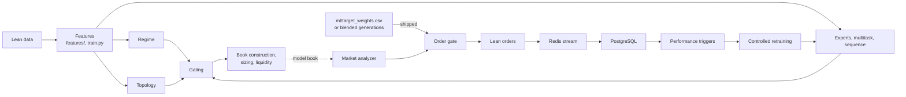

# Architecture

How the parts fit, and the rules each must keep. Package details are in each package's README; operations are in [`infrastructure.md`](infrastructure.md).

## Objective

Two jobs: test whether a model that adapts beats a static one, and give other algorithms a tested toolkit. Training and backtesting use the local Lean `data/` folder; paper and live stay gated behind broker keys.

## Flow

Every decision runs daily inside Lean's `on_data()`.

**Two paths through `on_data()`** (`main.py`, behind `phase_v2.target_weights.enabled`):

- **Target weights (shipped):** `_target_weights_tick` holds a hash-pinned file of weights, with no gates between a weight and its order. It keeps the kill switch and drawdown locks, and sweeps idle cash into T-bills.
- **Model book:** two passes. Pass 1 runs inference for every symbol and collects ranks. Between passes `build_rank_based_book()` chooses. Pass 2 runs sizing, liquidity, the analyzer and orders.

**Analyzer priority,** per asset per bar on the model path:

1. `reduce_risk`: trade lock active.
2. `reduce_risk`: risk-off regime, with a directional signal.
3. `reduce_risk`: elevated topology, with a directional signal.
4. `retrain_candidate`: baseline fallback and low regime confidence.
5. `simulate`: liquidity blocked or thin.
6. `simulate`: net edge below cost.
7. `trade`: all guards passed, confidence above threshold, not isolated.
8. `simulate` or `observe`: everything else.

## Module map

| Layer | Modules | Contract |
|---|---|---|
| Features | `features/`, `train.py` | One function for training and runtime; missing data is neutral, never a crash |
| Regime, topology, liquidity | `regime/`, `topology/`, `liquidity/` | Pure and deterministic, both inputs to the models and gates on the decision |
| Models | `experts/`, `moe/`, `train_*.py`, `inference/` | Exported to JSON, run by a numpy interpreter inside Lean, never torch |
| Decision | `portfolio/`, `risk/`, `analyzer/`, `execution/` | Pure and Lean-free, shared with the simulators |
| Persistence | `experience/`, `audit/` | Fire and forget, so a queue can never block or stop a trade |
| Learning | `performance/`, `retraining/`, `evaluation/research_*`, `ml/generations/` | Evidence moves a model; nothing learns live |
| Views | `monitoring/`, `webui/`, `visualization/`, `notifications/` | Read-only |
| Proof | `formal/`, `tests/` | The Lean 4 specs model the shared functions |

## Failure policy

- **Redis, Postgres or a broker down:** the algorithm keeps running, and events are skipped with a warning.
- **Missing model artifact:** the path falls back (experts to baseline, sequence to multitask, learned gating to the default blend).
- **Non-finite values:** `json_safety` helpers and explicit guards. A NaN can't size a position or pass a gate (`formal/README.md`).
- **Queues:** a poison row dead-letters; an outage re-raises and stays pending (#120).
- **Reports:** a report bug never fails the command that triggered it.

## Risk contracts

**Trade lock.** `main.py::_refresh_risk_state()` holds one sticky lock.

- **Writers:** a total-drawdown breach, or a kill-switch trip. Neither auto-clears within a run, because a circuit breaker that clears itself defeats the point (#9).
- **Manual override:** `aq trade-lock --on|--off|--auto` writes a standing override key read once per session rollover, so a long-running process picks it up without a restart. `risk/manual_override.py` is the one narrow place Python writes `config.json`.
- **On promotion:** a successful promotion clears the lock (`phase_v2.retraining.promotion.auto_clear_trade_lock`), tying "trading resumes" to "a new model shipped".

**Kill switch.** `evaluate_kill_switch()` is pure and per-bar. Every threshold defaults to a value it can't cross. A trip sets the existing lock, liquidates in paper and live (#289), and pushes a `live_mode_transition` audit event (`aq kill-switch --history`).

**Reconciliation.** `reconcile_positions()` compares intended and actual weights on the book-with-neutrality path, and a breach feeds the kill switch.

**Auto-rollback.** Off by default. `select_rollback_target()` needs live degradation, a minimum runway, a cooldown, and a target that passed validation.

**Backtest bypasses.** `phase_v2.backtest.bypass_*` flags exist only in backtests, because an unattended run has no human to clear a lock (#93).

**Runtime modes.** `observation` never trades. `backtest` always may. `paper` and `live` need the flags and healthy locks. `resolve_risk_exit_permission` lets a risk exit through when an entry would be blocked. The retraining worker can't auto-promote in `live` (`phase_v2.retraining.worker.auto_promote_blocked_in_live_mode`).

**Orders.** One pending order per symbol: a same-direction order is kept with its original clock, an opposite or timed-out one is replaced (`resolve_pending_order_action`). Exit tracking adopts a held position it has no state for. Slippage divergence counts only adverse market fills.

**Forex.** `build_forex_position_sizing` is margin-driven, so its weight is several times NAV; for a book member it's capped at the book's weight. Sizing compares target against held plus still-open quantity.

**Cash sweep (`phase_v2.cash_sweep`).** `portfolio/cash_sweep.py` sizes it from holdings and open orders, in `main.py` and the simulator alike. Risk controls read the strategy's own value (`advance_strategy_value`), because carry isn't performance.

## Offline/Live Parity Contract

The offline tools and `main.py` must make the same decisions from the same inputs, or an offline Sharpe says nothing about a backtest (AGENTS.md rule 6). **Anything `main.py` decides about signals, book, sizing, gates or orders is a pure function the offline simulator also calls, or it carries a parity test and a one-line justification here.** `main.py` is the live caller throughout.

| Decision | Shared function | Offline side |
|---|---|---|
| Book raw weights (`min(max_position_weight, 0.10 + 0.15·conf)·role`) | `build_book_raw_weights` (`portfolio/book_construction.py`) | `rank_book_simulator` (`live_weighting`) |
| Hysteresis anchor surviving a veto | `remember_formed_book` (same) | `rank_book_simulator` (`formed_book`) |
| Gates: confidence spread, rolling IC | `build_rank_based_book(... spread_check_ranks, rolling_ic_gate_result)`, `evaluate_rolling_ic_gate` | `rank_book_simulator` + `live_parity.make_rolling_ic_gate_fn` |
| Book-member weight floor, dynamic sizing, liquidity gate + `reduce_size`, net-edge gate + cost multiplier, analyzer verdicts for a member | `apply_book_weight_floor`, `build_dynamic_position_sizing`, `build_liquidity_decision`, `build_net_edge_decision`, `cost_sizing_multiplier` | `live_parity.build_live_member_weight_fn` -> `simulate_rank_book(member_weight_fn=)` |
| Kill switch | `evaluate_kill_switch` (`risk/kill_switch.py`) | `simulate_rank_book(kill_switch_config=)` |
| HRP book weights | `apply_hrp_weights`, `pct_returns_from_closes` | `live_parity.build_hrp_raw_weights_fn` -> `raw_weights_fn` (25-bar close windows from the dataset) |
| Almgren impact | `compute_sqrt_impact_bps` | per name on its own traded notional (`impact_inputs_fn`), real NAV |
| Rotation exit scope | `update_book_owned_symbols`, `is_rotation_exit_candidate` (same) | n/a (the simulator has no sleeve) |
| Legacy-signal budget | `apply_legacy_sleeve_policy`, `compute_sleeve_gross_used` (`portfolio/legacy_sleeve.py`) | modeled as zero-alpha, excluded |
| Forex target vs book weight | `cap_forex_target_to_book_weight` (`risk/forex_risk.py`) | the book weight itself |
| Pending quantity, forced-exit-only cooldown exemption, exit adoption | `projected_signed_quantity`, `is_cooldown_exempt(..., is_forced_exit)`, `compute_position_exit_tracking_update` (`risk_controls.py`) | `max_holding_dates` models the age exit |
| Hold book-owned positions through a veto | `should_hold_owned_position_on_veto` (`portfolio/book_construction.py`) | `hold_positions_on_veto` |
| Gate/cost spread cap per class | `cap_spread_proxy` (`liquidity/market_liquidity.py`) | `build_live_member_weight_fn` |
| One order per symbol | `resolve_pending_order_action`, `should_skip_for_open_order` (`execution/order_gate.py`) | `simulate_limit_fills` (fill rate only) |
| Fill slippage per side | `liquidity_cost_fraction(... "per_side")` | cost model bps per side |
| Volatility cutoff per asset class | `resolve_elevated_volatility_thresholds` (`topology/market_topology.py`) | `--calibrate-volatility-threshold` |
| Cross-asset payload inputs (topology, peers, macro proxies, cs momentum rank) | `cross_asset_inputs`, `CrossAssetTimeline` (`features/cross_asset_timing.py`) | `train.py` topology / macro / rank builders (bars available strictly before the row's tick) |
| Elevated-topology veto on new book entries | analyzer Priority 3 (`topology_veto_applies_to_book_members`) | `entry_veto_column` (as-live, from the dataset's `topology_risk_elevated`, built with the same per-class cutoffs) |
| Disabled asset classes take no book slots | `book_candidate_trading_eligible` (`risk/asset_class_router.py`) | `_universe_asset_metadata` -> `build_candidate_metadata` (as-live) |
| Per-class exchange fee (crypto) | `commission_terms_for_security_type`, `commission_bps_by_ticker` (`execution/cost_model.py`) | `simulate_rank_book(commission_bps_by_ticker=...)` |
| Point-in-time bond duration beta | `rolling_duration_beta`, `rolling_duration_beta_series` (`features/bond_features.py`), mode from `resolve_bond_duration_beta_mode` | `train.build_bond_features_by_date` (one value per row, equal to the live value on every row |
| Grouped rank normalisation (bonds / forex ranked among themselves) | `rank_group_by_symbol`, `grouped_cross_sectional_rank_scores` (`portfolio/rank_signal.py`) | `simulate_rank_book(rank_group_by_ticker=)`, `live_parity.build_rank_groups` / `main_group_tickers` |
| Class sleeves (forex, bond) | `build_class_sleeve_weights`, `resolve_class_sleeve_config` (`portfolio/class_sleeve.py`; forex wrappers in `portfolio/forex_sleeve.py`) | `aq_cli._universe_asset_metadata` takes a sleeve class out of the main pool |
| Forex sleeve signal (model rank, carry, momentum) | `fx_sleeve_scores` (`features/fx_signals.py`) | `scripts/forex_sleeve_research.py` |
| Sleeve loss guard | `evaluate_sleeve_guard` (`portfolio/sleeve_guard.py`) | `simulate_rank_book(sleeve_guard_config=)` on the book's own simulated returns |
| Venue listing / delisting / suspension | `asset_listed_on_venue`, `load_venue_listing_dates` (`risk/asset_class_router.py`; data from `scripts/coinbase_listing_dates.py`) | `simulate_rank_book(venue_listing_dates=)`, `live_parity.load_live_venue_listing_dates` |
| Target-weights path: decision, order deltas, equity fee, T-bill reserve | `weights_at_tick`, `rebalance_deltas`, `equity_fee_usd`, `sweep_reserve` (`portfolio/target_weights.py`) | `evaluation/target_weights_engine.py` (R-INSTR1 |
| Financing Lean does not charge | `daily_financing_usd`, `rate_asof` (`portfolio/financing.py`) | `simulate_target_weights`, added to its cash |
| A held name whose bars stopped | `update_missing_bars`, `names_to_exit_without_bars`, `no_bar_exit_cost_usd` (`portfolio/target_weights.py`) | Same counts and haircut |
| A lock's exits on the target path | equities at the next open, crypto and forex on their own next bar | BT26 |
| RL sizing and its shadow guard | `rl_sizing_multiplier`, `rl_excess_return`, `rl_shadow_guard_allows` (`risk/rl_sizing.py`) | `live_parity.build_live_member_weight_fn(rl_model=, daily_returns_by_date=)` calls the same sizing function and the same guard |
| Slippage reference price | `slippage_reference_price` (`execution/order_gate.py`) | live-only (the simulator has no fills) |
| Regime inputs the models read (drawdown-free) | `build_model_input_regime_vector` (`regime/market_regime.py`) | `train._encode_regime_row` calls the same function |
| Rebalance cadence (equity sessions only) | `should_rebalance_this_bar` (`portfolio/book_construction.py`) | `simulate_rank_book(rebalance_session_dates=, rebalance_counter_start=)` |
| Next-open fill of a decided order | one-bar entry lag + the next session's open-to-close move | `simulate_rank_book(intraday_next_return_column=)` / `live_parity.add_next_intraday_return` |
| Resize threshold, entry cooldown, trailing stop | `should_scale_position`, `is_cooldown_exempt` semantics, `evaluate_non_model_exit` (`risk_controls.py`) | `simulate_rank_book(resize_threshold_weight=, trade_cooldown_dates=, trailing_stop_pct=)`, from `build_as_live_kwargs` |
| IB per-order dollar floor | `min_commission_usd_by_ticker` (`execution/cost_model.py`) | `simulate_rank_book(min_commission_usd_by_ticker=)` via `AsLiveHarness` |
| Class-neutral book slots | `normalize_per_asset_class_slots` (`portfolio/book_construction.py`) | `simulate_rank_book(per_asset_class_slots=)` from `build_as_live_kwargs` |
| Which exits may rest as a limit order; per-class limit offset / timeout | `resolve_exit_order_route`, `resolve_limit_setting_by_class` (`execution/order_gate.py`) | fees only |
| Fill-forward forex bar | `flatten_fill_forward_bar` (`data_pipeline/bar_synthesis.py`) | `train.fill_forward_forex_frame` (the dataset's definition |
| Late-bar (crypto / forex) cross-asset payloads on the equity tick | `LateBarCrossAssetCache` (`features/cross_asset_timing.py`) | `CrossAssetTimeline` key D + 1.0 = the symbol's own tick |
| Lean's benchmark | `resolve_benchmark_ticker` (`risk_controls.py`) | reporting only |
| Legacy probability signal (buy / sell / hold, adaptive sell band) | `derive_signal`, `adaptive_sell_threshold` (`data_pipeline/bar_synthesis.py`), `resolve_legacy_signal_params` (`portfolio/legacy_sleeve.py`) | `simulate_rank_book(legacy_component=)` through the same functions |
| Daily member pass between rebalances | Pass 2's member branch over `_last_book_allocations`, the member chain (`build_live_member_weight_fn`) | `simulate_rank_book(mid_cycle_member_updates=)` |
| Analyzer verdicts for a member or legacy entry | `build_market_analysis_decision` (`analyzer/market_analyzer.py`) | `build_live_member_weight_fn(use_live_analyzer=True)` calls it itself |
| Kill switch on the whole portfolio | `evaluate_kill_switch`, `is_sticky_trade_lock_bypass_active` | `simulate_rank_book(kill_switch_extra_returns=)` adds the P&L outside the simulation (bond / forex sleeves) to the kill ... |
| Open-position cap | `phase9.portfolio.max_active_positions` | `simulate_rank_book(max_active_positions=)` |
| Crypto weekends | live trades every calendar day | `simulate_rank_book(accrue_skipped_dates=)` |
| Rolling-IC event buffer (a late-bar symbol is counted twice per date) | `with_live_event_duplicates` (`evaluation/live_parity.py`) | `make_rolling_ic_gate_fn(late_bar_tickers=)`, `AsLiveHarness.gate_for` |
| Rolling-IC gate warm start | live's event buffer fills through the 260-bar warm-up | `AsLiveHarness(gate_warmup_days=)` scores the rows before the split too |
| Seed ensembles | `average_head_outputs` (`inference/exported_model.py`) | `evaluation.model_predictions.predict_heads_ensemble` |
| Lean's forex market holidays | `lean_market_holidays`, `resolve_forex_lean_holidays` (`features/cross_asset_timing.py`) | the dataset's forex calendar (`phase1.features.forex_lean_holidays`), the timeline and the parity replica |
| Kill-switch trip confirmation | `evaluate_kill_switch` + `KillSwitchDecision.rolling_sharpe_below_run` (`risk/kill_switch.py`): the rolling-Sharpe trip needs N consecutive readings below the floor, the counter carried bar to bar | `simulate_rank_book(kill_switch_config=)` and `evaluation/kill_switch_replay.py` thread the same counter |
| Sector-relative rank normalisation | `grouped_cross_sectional_rank_scores(..., sector_by_symbol)`, `sector_relative_scores` (`portfolio/rank_signal.py`) | `simulate_rank_book(sector_relative_rank=)`, set by `build_as_live_kwargs(rank_signal_config=)` |
| Expert exclusion in the legacy signal | `build_gating_decision(excluded_experts=)` (`moe/gating.py`): an excluded expert has no probability, the others renormalise | `scripts/build_legacy_probability.py` (`legacy_probability_from_components`) |
| Direction-probability overlay | `apply_direction_overlay`, `calibrate_probability` (`portfolio/direction_overlay.py`) | `simulate_rank_book(rank_overlay_fn=)` applies it to the percentile ranks, before the book, as live would |
| Crypto graduates out of the main book | `crypto_core_only_settings`, `crypto_graduate_excluded` (`portfolio/book_construction.py`) | the simulator's candidate metadata through the same function |
| Partial adjustment toward the target on a rebalance | `partial_adjust_weights` (`portfolio/book_construction.py`) | `simulate_rank_book(partial_adjust_fraction=)` |
| Book-history log by run mode | `book_history_mode_allowed` (`portfolio/book_construction.py`): backtests log the full record, paper (`diagnostics.book_history.paper_enabled`) the bounded one, live never | n/a (a diagnostic |
| Book-call probabilities in the book history | `build_book_history_record(member_probabilities=)` | `evaluation/classification_parity.py` scores the offline head on the same calls (R-L11 tolerance) |

**Live-only, by design**

- **Target-weights path:** a file executor in Lean. The file's rows come from `portfolio/premia_signals.py`, and `scripts/daily_target_weights.py` runs before each open in paper.
- **Forward observers (g0002-g0005, zero capital):** `scripts/cycle_daily.py` builds a crypto observer's table with `portfolio/crypto_signals.forward_table`, the same builder functions the research round scored, on Coinbase candles; k09 is built by `scripts/k09_decide.py` from the same `extended_info_features` as its research cell. None of them reaches `main.py`, so there is no second implementation to drift.
- **`resolve_risk_exit_permission`, `_target_premarket_tick`:** a backtest always may trade, and its file doesn't change.
- **The buying-power reserve before a rebalance:** Lean checks at submission; the simulator has no buying-power model and applies the same reserve.
- **`runtime.trading_days_per_year`:** measurement only. Lean's reported statistics use it, and the simulator annualises its trading-date series at 252.

**Offline only, until a rule adopts it:** the tranche book (`evaluation/tranche_book.py`), the direction overlay, ranked model inputs, the trend sleeve. A live path must be built and pass parity first.

**Not modelled by the rank-book simulator:** the predicted-volatility head. See `aq evaluate --calibrate-sim-lean`: that simulator tracks Lean at about 0.44-0.73 daily correlation, against above 0.99 for the target-weights engine.

**Data parity** is checked against live, not against code (AGENTS.md rule 12): `features/cross_asset_timing.py` is the one definition of what a tick can see. After a feature or dataset change, compare a backtest's `feature_snapshot` with `aq evaluate --reconcile-features`.

## Model contracts

- **Exports:** `ml/*.json`, run by `inference/exported_model.py`. The flat and branching exports aren't interchangeable.
- **Inputs:** a model's own `model_input_features` select its inputs in `main.py` and `model_predictions.predict_heads`.
- **Promotion gates:** `*_ranking_quality` per head and era (`aq evaluate --audit-heads`). `rank_signal` falls open when every head fails, and reports it.
- **Labels:** `phase1.target.ranking.beta_estimation` (`train.py` only) picks whole-history or as-of betas.
- **Seed ensembles (`phase_v2.model_ensemble`, off):** one rule, `average_head_outputs`, in `main.py` and every offline scorer.
- **Experts:** a post-training gate marks `stable`, `watchlist` or `disabled_for_gating`.

## Learning contracts

**Performance triggers.** Durable rows in `performance_triggers`, written by a worker over a rolling window. `main.py`'s in-memory view is for the dashboard only.

**Controlled retraining.** Plan, train in isolation, validate, backtest, commit to the vault, promote, with rollback always available. One `active` version, enforced by the database. Missing metrics fail closed (#122).

**Research cycle.** Separate from triggered retraining, and evidence-gated:

- **Rules first:** a round's rules are hashed before any score (`evaluation/research_round.py`).
- **Reads enforced in code:** `evaluation/research_cells.py` refuses held-out cells without a freeze digest. `ml/generations/holdout_ledger.jsonl` refuses a second read.
- **Generations:** registry, lifecycle log and policy live in `ml/generations/`. Nothing in Lean reads them.
- **Admission and glide:** R-ADMIT1 and R-GLIDE2 (RUNBOOK "Research cycle").
- **Blending:** `blend_generation_rows` over decision rows. R-BLEND1 and R-BLEND2 proved in Lean that a blend reproduces its inputs.
- **Forward records:** on branch `forward-ledger`, written by free runners.

**Proofs.** `formal/AetherFormal/*.lean` model the functions both paths call. A change to one changes its spec or fails `tests/test_formal_differential_*.py`. Nothing in the trading path imports `aether_quant`.

## Webui and API

The server is read-only and torch-free. Every section degrades to a not-evaluated view rather than an error. Dashboard state is polled; `/api/grafana/*` is a historical name, since Grafana itself was removed.

## Diagnostics

Default off in code, enabled per run, and never on the live hot path without need (AGENTS.md rule 11):

- **`phase_v2.diagnostics.book_history`:** per-rebalance records, in backtests and optionally paper.
- **`phase_v2.diagnostics.state_write`:** throttles state writes.
- **`phase_v2.diagnostics.timing_probe`, `crypto_bar_probe`:** timing and bar probes (`performance_probe.py`).

## Latency

Daily bars keep the budget generous, and the discipline is about keeping a run feasible on a small host:

- **Heavy imports stay out of Lean startup** (#16). Creation runs under `algorithm-creation-timeout`.
- **The hot path allocates nothing new per bar without need.** Batched inference and cached weight stacks cut its profiled cost by about 89% (#31, #32).
- **Topology is the largest single cost:** vectorized correlation, warm starts and an optional embedding cache. `aq profile` measures each subsystem.

## Why this isn't HFT

Standing analysis, kept so the question isn't re-investigated.

1. **Daily bars everywhere:** data, features, targets and warm-up. HFT needs tick or L1/L2 data, which is a different storage layer.
2. **About one decision per symbol per few days,** and a trade cooldown.
3. **Execution:** limit orders and a slippage model exist, but no queue-position or latency modelling.
4. **Retraining is a gated batch,** not continuous learning.
5. **Infrastructure polls:** workers run every 30 seconds to 5 minutes, and the loop is Lean's daily callback.
6. **No colocated exchange connectivity,** or any live broker yet.

Closing these gaps would be a second, parallel system, not a change to this one: a tick pipeline first, then a short-horizon model on minute or second data, then latency-aware execution and an event-driven runtime.
