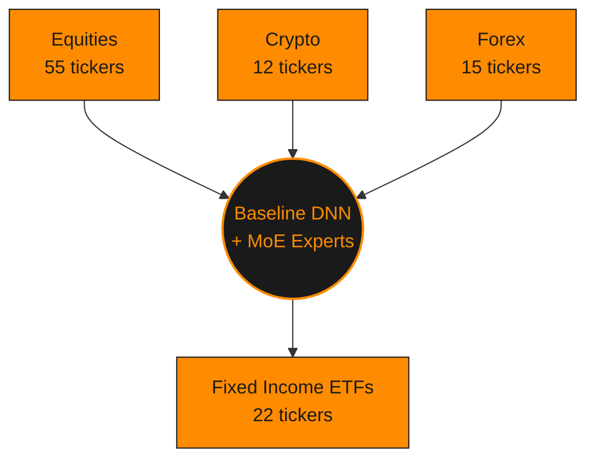

# Asset Universe

The trading universe currently spans **104 assets**: 55 stocks/broad-market
ETFs, 22 fixed-income (bond) ETFs, 12 crypto pairs, and 15 forex/FX pairs.
It is defined in `config.json`'s `phase1.universe.assets` and
shared across training, validation, and backtesting
(`phase1.universe.common_window`: `2014-12-01` to `2025-06-30`; V5.8.0 moved it from `2021-03-31`). Splits: train 2014-12-01..2021-12-31, validation 2022-01-01..2023-06-30, backtest 2023-07-01..2025-06-30, plus a holdout 2025-07-01..2026-10-16 (`phase1.windows.holdout`; its first read covered 2025-07-01..2026-09-30, V6.4.0 only appended 12 sessions and reads it where a lead's bar names it, each read logged in `ml/evaluation/v640/research.json`). Every class is one Yahoo-sourced vintage through 2026-09-30, extended to 2026-10-16 by an append-only refresh (`scripts/data_append_refresh.py`, Problems #215): no stored row moved.

The universe was deliberately grown — from an original 30 assets
(`Problems.md` #52) to add bonds/crypto, then 15 forex pairs in V4.10
(`Problems.md` #66), then 15 sector-filling equities in Phase 4.12
(WFC, GS, HON, CAT, BA, UNP, GE, ABT, MRK, NKE, SBUX, ORCL, ADBE, TXN, T,
`Problems.md` #71) — specifically to strengthen the cross-sectional
`rank_20d` signal, which scales with names-per-date. Today's mix is 53%
equity / 21% bond / 12% crypto / 14% forex by count; all Phase-4.12
additions are confirmed **Trading**-eligible in that retrain's
`ml/dataset_manifest.json`.

The bond ETF sleeve (Phase 1 of the 5/10 to 9/10 roadmap, see
[`Changelog.md`](Changelog.md)) spans the duration curve
(short/intermediate/long/aggregate) and credit spectrum
(Treasury/investment-grade/high-yield/municipal/emerging-market/international)
so the yield-curve-slope and credit-spread macro proxies computed from it
(`features/macro_features.py`) are meaningful. Bond ETFs are registered with
`security_type: "equity"` (they trade through Lean's ordinary equity
subscription path, like every other ETF already in the universe, e.g.
SPY/QQQ/IWM/EEM, not a new Lean security type).

## Full ticker list

| Ticker | Type | Role |
|---|---|---|
| AAPL | Equity | Trading |
| SPY | Equity | Trading |
| QQQ | Equity | Trading |
| IWM | Equity | Trading |
| EEM | Equity | Trading |
| BAC | Equity | Trading |
| IBM | Equity | Trading |
| AIG | Equity | Trading |
| BNO | Equity | Trading |
| FB | Equity | Trading |
| GOOG | Equity | Trading |
| GOOGL | Equity | Trading |
| USO | Equity | Trading |
| WM | Equity | Trading |
| AAA | Equity | Trading (V5.8.0: enough rows after the window move) |
| MSFT | Equity | Trading |
| NVDA | Equity | Trading |
| AMZN | Equity | Trading |
| JPM | Equity | Trading |
| XOM | Equity | Trading |
| JNJ | Equity | Trading |
| PG | Equity | Trading |
| KO | Equity | Trading |
| DIS | Equity | Trading |
| HD | Equity | Trading |
| WMT | Equity | Trading |
| V | Equity | Trading |
| MA | Equity | Trading |
| UNH | Equity | Trading |
| CVX | Equity | Trading |
| PFE | Equity | Trading |
| VZ | Equity | Trading |
| CSCO | Equity | Trading |
| INTC | Equity | Trading |
| MCD | Equity | Trading |
| ABBV | Equity | Trading |
| CRM | Equity | Trading |
| COST | Equity | Trading |
| PEP | Equity | Trading |
| TMO | Equity | Trading |
| WFC | Equity | Trading |
| GS | Equity | Trading |
| HON | Equity | Trading |
| CAT | Equity | Trading |
| BA | Equity | Trading |
| UNP | Equity | Trading |
| GE | Equity | Trading |
| ABT | Equity | Trading |
| MRK | Equity | Trading |
| NKE | Equity | Trading |
| SBUX | Equity | Trading |
| ORCL | Equity | Trading |
| ADBE | Equity | Trading |
| TXN | Equity | Trading |
| T | Equity | Trading |
| SHY | Equity (Fixed Income ETF) | Trading - short-duration Treasury (1-3y) |
| IEF | Equity (Fixed Income ETF) | Trading - intermediate-duration Treasury (7-10y) |
| TLT | Equity (Fixed Income ETF) | Trading - long-duration Treasury (20y+) |
| AGG | Equity (Fixed Income ETF) | Trading - broad aggregate bond benchmark |
| LQD | Equity (Fixed Income ETF) | Trading - investment-grade corporate |
| HYG | Equity (Fixed Income ETF) | Trading - high-yield corporate |
| TIP | Equity (Fixed Income ETF) | Trading - inflation-protected (TIPS) |
| MBB | Equity (Fixed Income ETF) | Trading - mortgage-backed |
| EMB | Equity (Fixed Income ETF) | Trading - emerging-market sovereign debt |
| MUB | Equity (Fixed Income ETF) | Trading - municipal |
| BND | Equity (Fixed Income ETF) | Trading - broad aggregate bond benchmark |
| GOVT | Equity (Fixed Income ETF) | Trading - broad Treasury benchmark |
| SHV | Equity (Fixed Income ETF) | Trading - ultra-short Treasury |
| IGIB | Equity (Fixed Income ETF) | Trading - intermediate investment-grade corporate |
| VCIT | Equity (Fixed Income ETF) | Trading - intermediate investment-grade corporate |
| VCSH | Equity (Fixed Income ETF) | Trading - short investment-grade corporate |
| BIV | Equity (Fixed Income ETF) | Trading - intermediate aggregate |
| BSV | Equity (Fixed Income ETF) | Trading - short aggregate |
| TLH | Equity (Fixed Income ETF) | Trading - long-duration Treasury (10-20y) |
| IGSB | Equity (Fixed Income ETF) | Trading - short investment-grade corporate |
| JNK | Equity (Fixed Income ETF) | Trading - high-yield corporate |
| BWX | Equity (Fixed Income ETF) | Trading - international Treasury |
| BTCUSD | Crypto | Trading |
| ETHUSD | Crypto | Trading, capped (graduate: 1% per name, 5% class, loss guard) |
| LTCUSD | Crypto | Trading |
| XRPUSD | Crypto | Trading, capped (graduate: 1% per name, 5% class, loss guard) |
| ADAUSD | Crypto | Trading, capped (graduate: 1% per name, 5% class, loss guard) |
| BCHUSD | Crypto | Trading, capped (graduate: 1% per name, 5% class, loss guard) |
| LINKUSD | Crypto | Trading, capped (graduate: 1% per name, 5% class, loss guard) |
| DOGEUSD | Crypto | Trading, capped (graduate: 1% per name, 5% class, loss guard) |
| XLMUSD | Crypto | Trading, capped (graduate: 1% per name, 5% class, loss guard) |
| EOSUSD | Crypto | Trading, capped (graduate: 1% per name, 5% class, loss guard) |
| ETCUSD | Crypto | Trading, capped (graduate: 1% per name, 5% class, loss guard) |
| ZECUSD | Crypto | Trading, capped (graduate: 1% per name, 5% class, loss guard) |
| EURUSD | Forex | Carry-ranked sleeve (gross 0.10, loss guard); never in the main book pool |
| GBPUSD | Forex | Carry-ranked sleeve (gross 0.10, loss guard); never in the main book pool |
| USDJPY | Forex | Carry-ranked sleeve (gross 0.10, loss guard); never in the main book pool |
| AUDUSD | Forex | Carry-ranked sleeve (gross 0.10, loss guard); never in the main book pool |
| USDCAD | Forex | Carry-ranked sleeve (gross 0.10, loss guard); never in the main book pool |
| USDCHF | Forex | Carry-ranked sleeve (gross 0.10, loss guard); never in the main book pool |
| NZDUSD | Forex | Carry-ranked sleeve (gross 0.10, loss guard); never in the main book pool |
| EURGBP | Forex | Carry-ranked sleeve (gross 0.10, loss guard); never in the main book pool |
| EURJPY | Forex | Carry-ranked sleeve (gross 0.10, loss guard); never in the main book pool |
| GBPJPY | Forex | Carry-ranked sleeve (gross 0.10, loss guard); never in the main book pool |
| EURCHF | Forex | Carry-ranked sleeve (gross 0.10, loss guard); never in the main book pool |
| EURAUD | Forex | Carry-ranked sleeve (gross 0.10, loss guard); never in the main book pool |
| AUDJPY | Forex | Carry-ranked sleeve (gross 0.10, loss guard); never in the main book pool |
| CADJPY | Forex | Carry-ranked sleeve (gross 0.10, loss guard); never in the main book pool |
| GBPCAD | Forex | Carry-ranked sleeve (gross 0.10, loss guard); never in the main book pool |

## Trading vs observation-only

"Observation-only" assets (Phase 9's `asset_quality` gate) are still fed
through the full model/expert/topology pipeline every bar and visible on the
dashboard, but are never sized into real positions: their real history is too
short relative to the training window to be trusted for trading decisions (see
[`Changelog.md`](Changelog.md) for the exact row-count thresholds). This is
re-evaluated automatically every time `train.py` rebuilds the dataset, so an
asset can move between these two roles as more history accumulates.

**V5.8.0: all 104 assets are training- and trading-eligible.** Moving the train split to 2021-12-31 gave
every crypto pair (Yahoo history from 2017-11-09) well over the 250 training rows the `asset_quality` rule asks for,
and AAA (from 2020-09) enough as well (`ml/dataset_manifest.json`). The ten crypto pairs that were observation-only
trade as capped "graduates" (`phase_v2.crypto_graduates`: 1% per name, 5% for the class, a loss guard, and the venue
listing guard that blocks orders before a pair's Coinbase listing or during the XRP suspension). Bonds are no longer in
the main book pool: they run as a momentum-ranked sleeve (`phase_v2.bond_sleeve`, gross 0.10 after BT1,
`max_bond_exposure` 0.3 stays the hard cap) and forex as a carry-ranked sleeve (`phase_v2.forex_sleeve`, gross 0.10) until V6.0.0, which dropped it by rule R-FX6 (`forex_risk.enabled` false: the pairs are observation-only, their bars still feed the cross-asset features; Problems.md #181). Crypto graduates trade at 0.5% per name / 2.5% class since V6.0.0 (#180).
The history below describes the older observation-only state. (Two of the original 7 picks,
BNBUSD/TRXUSD, were swapped for ETCUSD/ZECUSD after a real `aq backtest` run
found Coinbase never actually listed Binance Coin or TRON pairs. Lean's local
symbol-properties database confirmed it, so those two could never subscribe.
ETCUSD/ZECUSD are real Coinbase-listed pairs with the same 2017-11-09 Yahoo
history start as the rest of this batch.)

**All 15 forex pairs are training-eligible** (confirmed at the V4.11 retrain, still true; since V5.8.0 they trade only through the carry sleeve)
(`development/Problems.md` #70). The first-ever full `train.py` run that
included forex classified all 15 pairs training-eligible via the same
`asset_quality` classifier used for every other asset class (trainable
universe 74 → 78). This required two fixes surfaced by that run: `train.py`
could not read the forex bid/ask quote-bar format at all (now collapsed to a
midpoint trade bar, matching runtime), and 4 forex majors initially landed
observation-only because the Codespace held a stale 2007–2018 data vintage —
re-syncing the current 2014–2021 data resolved it. The "Trading (expected)"
caveat that stood here in V4.10 is now settled.

## Group-level view

Asset classes sit on opposite sides of the hub (equities/crypto feed in from
above, fixed income from below) rather than a single top row. Ticker detail is
in the table above; this is the group-level view:

